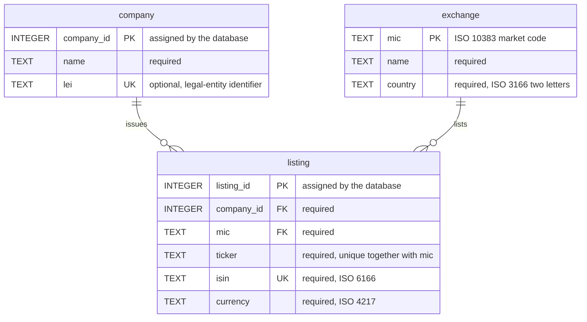

# ADR 0001: Core reference schema for exchanges, companies and listings

- Status: Accepted. The `listing` table is superseded by ADR 0003; `exchange` and `company` stand.
- Date: 2026-11-20

## Decision

Three tables describe what pyvalue analyses. None of them holds anything that belongs to a data provider.

| Table | One row is |
|---|---|
| `exchange` | A market on which companies list |
| `company` | A legal entity that issues listed shares |
| `listing` | One listed security of a company, on its home market |

A company has one or more listings. Each listing trades on exactly one exchange.

## Diagram



`PK` is a primary key, `FK` a foreign key, `UK` a unique column.

## Tables

How to read the tables below:

- **Key**: `PK` is the primary key. `FK → table.column` is a foreign key to that column. `UNIQUE` means no two rows share the value.
- **Required**: `yes` means the column can never be empty.

### `exchange`

One row per market on which companies list.

| Column | Type | Key | Required | Constraint | Meaning |
|---|---|---|---|---|---|
| `mic` | TEXT | PK | yes | Exactly four upper-case letters or digits | The market's ISO 10383 code |
| `name` | TEXT | | yes | Not empty, no leading or trailing spaces | The market's name |
| `country` | TEXT | | yes | Exactly two upper-case letters | The market's ISO 3166 country code |

Example rows:

| `mic` | `name` | `country` |
|---|---|---|
| `XNYS` | New York Stock Exchange | `US` |
| `XNAS` | Nasdaq | `US` |
| `XETR` | Xetra | `DE` |
| `XJPX` | Japan Exchange Group | `JP` |
| `XKOS` | KOSDAQ | `KR` |

Notes:

- **`mic` is the primary key** because it is an international standard and stable.
- **Which code a market gets.** ISO 10383 has operating codes and segment codes beneath them. A row uses the operating code by default: AIM (`AIMX`) is stored as London (`XLON`), and NYSE American (`XASE`) as New York (`XNYS`). A segment code gets its own row only where two separate listing markets share one operating code: KOSDAQ (`XKOS`) sits under Korea Exchange (`XKRX`) but is a different market from KOSPI.
- **Resolving a source's code.** A source that reports a code with its own row resolves to that row. Otherwise it resolves to the row of the code's operating code.

### `company`

One row per legal entity that issues listed shares.

| Column | Type | Key | Required | Constraint | Meaning |
|---|---|---|---|---|---|
| `company_id` | INTEGER | PK | yes | Assigned by the database, never reused | pyvalue's own id for the company |
| `name` | TEXT | | yes | Not empty, no leading or trailing spaces | The company's name |
| `lei` | TEXT | UNIQUE | no | 20 upper-case letters or digits, the last two being digits | The company's ISO 17442 legal-entity identifier, where it has one |

Example rows:

| `company_id` | `name` | `lei` |
|---|---|---|
| 1 | Berkshire Hathaway Inc | `5493000C01ZX7D35SD85` |
| 2 | Alphabet Inc | `5493006MHB84DD0ZWV18` |
| 3 | SAP SE | `529900D6BF99LW9R2E68` |
| 4 | Toyota Motor Corp | `5493006W3QUS5LMH6R84` |

Notes:

- **`company_id` is a surrogate key** because no identifier covers every company.
- **`lei` is optional** because many companies have none. Any number of companies may have an empty `lei`; two companies can never share one. It is the schema's guard against entering the same company twice.
- **`name` is not unique**: different companies can share a name.

### `listing`

One row per listed security, on its home market.

| Column | Type | Key | Required | Constraint | Meaning |
|---|---|---|---|---|---|
| `listing_id` | INTEGER | PK | yes | Assigned by the database, never reused | pyvalue's own id for the listing |
| `company_id` | INTEGER | FK → `company.company_id` | yes | The company must exist | The company that issued the security |
| `mic` | TEXT | FK → `exchange.mic` | yes | The exchange must exist | The exchange the security trades on |
| `ticker` | TEXT | UNIQUE together with `mic` | yes | Not empty, no leading or trailing spaces, upper case | The exchange's own ticker for the security |
| `isin` | TEXT | UNIQUE | yes | 12 characters: two letters, nine letters or digits, one digit | The security's ISO 6166 identifier |
| `currency` | TEXT | | yes | Exactly three upper-case letters | The ISO 4217 currency the security trades in |

Example rows:

| `listing_id` | `company_id` | `mic` | `ticker` | `isin` | `currency` |
|---|---|---|---|---|---|
| 1 | 1 (Berkshire Hathaway) | `XNYS` | `BRK.B` | `US0846707026` | `USD` |
| 2 | 2 (Alphabet) | `XNAS` | `GOOGL` | `US02079K3059` | `USD` |
| 3 | 2 (Alphabet) | `XNAS` | `GOOG` | `US02079K1079` | `USD` |
| 4 | 3 (SAP) | `XETR` | `SAP` | `DE0007164600` | `EUR` |
| 5 | 4 (Toyota) | `XJPX` | `7203` | `JP3633400001` | `JPY` |

Notes:

- **Primary listing only.** A row is the line on the market where the security has its primary listing. Secondary lines of the same security on other markets are not stored. Because `isin` is unique, there is one row per security, so there is no primary/secondary status column and no classification step.
- **Several listings per company.** A company has one row per listed security, each with its own ISIN: Alphabet's two share classes above, a common and a preferred share, or a Chinese company's mainland and Hong Kong shares.
- **Depositary receipts.** A receipt gets a row only when it is the company's own primary listing. It is never stored as a stand-in for shares whose home market is elsewhere.
- **`listing_id` is a surrogate key.** Both natural keys, `isin` and `mic` plus `ticker`, are unique but can change (a ticker rename, a new ISIN after a corporate action). When one changes, the row is updated and `listing_id` stays the same.
- **`ticker` is the exchange's ticker**, written as the exchange writes it. It is not a provider's symbol.
- **`currency` is not a quote unit.** A London line is `GBP` even though its prices are quoted in pence. How prices are quoted is decided with price data.

### Rules for all three tables

| Rule | What it means |
|---|---|
| ISO identifiers only | The tables hold standard identifiers (market code, ISIN, legal-entity identifier, country, currency) and nothing that belongs to one provider. |
| Ids are never reused | A deleted row's id is never given to a new row, so an id in an old output file can never come to mean a different company. |
| Nothing is deleted implicitly | A company or exchange that still has listings cannot be deleted. |
| A changed `mic` follows through | If an exchange's code is corrected, its listings are updated with it. |
| Check digits are validated in code | The constraints enforce the shape of an ISIN and a legal-entity identifier. Their check digits cannot be computed in a constraint, so the code that writes a row validates them first. |
| Foreign keys are switched on | The database is opened with `PRAGMA foreign_keys = ON`. |

### What the schema does not enforce

| Not enforced | Who guards it |
|---|---|
| That the stored line is the security's home line | The step that loads holdings. The schema only guarantees one line per security. |
| That a company without a legal-entity identifier is entered once | The step that loads holdings |
| That a company has at least one listing | Nothing |

## Indexes

| Index | Created by | Query it serves |
|---|---|---|
| `listing (isin)` | The `UNIQUE` constraint | Find a listing by ISIN when holdings are loaded |
| `listing (mic, ticker)` | The `UNIQUE` constraint | Resolve an exchange and ticker typed by a person; list the listings on an exchange |
| `listing (company_id)` | `listing_company_id` | List a company's listings; check the foreign key when a company is deleted |
| `company (lei)` | The `UNIQUE` constraint | Find a company by its legal-entity identifier |

There is no separate index on `listing (mic)`: it is the leading column of the (`mic`, `ticker`) index.

## Normalisation

All three tables are in Boyce-Codd normal form, with no deliberate deviation. Every column depends only on its table's key. In `listing`, `currency` does not depend on `mic`, because one exchange trades lines in several currencies.

## Why this design

pyvalue builds its stock universe from the holdings of a few broad equity funds, not from a provider's catalogue of listings. These tables have to be settled before the funds are chosen, because holdings, prices, fundamentals and metrics will all point at them.

The legacy project's equivalent tables taught three lessons:

| Legacy problem | What this schema does instead |
|---|---|
| Every line the vendor listed was stored (75,680 listings) and classified as primary, secondary or unknown from vendor fields. 19,935 stayed unknown and the rules needed repeated repair. | Only the home line is stored, so nothing is classified. |
| A company was identified by name plus country. Country was missing on 65,752 of 70,564 rows, so in practice every listing got its own company. | The legal-entity identifier is the unique identifier, from the start. |
| Exchanges were identified by the vendor's codes. | Exchanges are identified by the ISO market code. |

The author's constraints: keep it simple, store only the primary listing, and keep these tables independent of any data provider. Provider identifiers are the subject of ADR 0002.

## Evidence

Measured on 2026-11-20 unless stated.

**ISINs are available for practically every holding.** Equity lines carrying an ISIN that passes format and check digit:

| Source | Holdings date | Lines with a valid ISIN |
|---|---|---|
| SPDR MSCI ACWI IMI UCITS ETF, sponsor file | 2026-11-19 | 6,064 of 6,115 (all lines, including cash) |
| iShares Micro-Cap ETF, SEC N-PORT | 2026-06-30 | 1,372 of 1,373 |
| Vanguard FTSE All-World ex-US Small-Cap, SEC N-PORT | 2026-07-31 | 4,830 of 4,839 |
| Vanguard Total World Stock, SEC N-PORT | 2026-07-31 | 10,063 of 10,072 |

The lines without one are cash, derivatives, rights, and delisted or temporary lines left by corporate actions. In each of the three SEC filings they are under 0.03% of net assets.

**The legal-entity identifier is far from universal.** Equity lines in the SEC filings carrying a valid one:

| Fund | Share of lines | Share of net assets |
|---|---|---|
| Vanguard Total World Stock | 69% | 95% |
| Vanguard FTSE All-World ex-US Small-Cap | 54% | 71% |
| iShares Micro-Cap ETF | 58% | 65% |

The gaps are mostly in China, Japan, Taiwan, Korea and among US micro-caps.

**Other findings:**

- **Looking an ISIN up is not reliable.** OpenFIGI does not return ISINs, and 22,122 of the 75,680 legacy listings had none from the vendor (measured 2026-11-15). The ISIN has to come from the holdings source.
- **Several listings per company is a real case.** In Vanguard Total World, 235 of the 6,711 issuers that carry a legal-entity identifier have two or more ISINs: 135 with lines in different countries (such as mainland China and Hong Kong shares), 72 with two or more common-share lines in one country (such as Volvo A and B), and 28 with a common and a preferred share.
- **Not every holdings line with an ISIN is a listing.** Air Liquide appears on four lines with four ISINs in that filing; three appear to be loyalty-bonus share lines, which do not trade separately.
- **One security can be held on two markets.** Eleven ISINs in Vanguard Total World sit on two lines, such as Brookfield in Toronto and New York. The SPDR file holds Sunbelt Rentals in London and New York under one ISIN.
- **ISO 10383 levels.** The published table has 2,304 active codes, of which 1,331 are operating codes. `XKOS` is a segment of `XKRX`, `XTKS` of `XJPX`, `AIMX` of `XLON`, and `XASE` of `XNYS`.

## Consequences

- **The primary/secondary classification disappears.** A row exists only for a home line, so nothing downstream filters by listing status.
- **A holdings source must carry ISINs.** SEC N-PORT filings and UCITS sponsor files do. The iShares US holdings files do not.
- **Ticker and exchange need a lookup for some sources.** N-PORT filings and the SPDR file carry neither. The load step has to find both before it can write a row.
- **A line that cannot be completed is not loaded, and is reported.** That covers a line with no ISIN and a line whose ticker or exchange cannot be found.
- **Duplicate companies remain possible where there is no legal-entity identifier**, which is 31% to 46% of equity lines by count in the three SEC filings.
- **The load step must leave out holdings lines that are not listings**, such as loyalty-bonus share lines.
- **Identifier history is not kept.** A changed ticker or ISIN overwrites the old value.
- **Storing secondary listings later would change this schema.** The ISIN would move to a table of its own, by a new record that supersedes this one.

## Alternatives considered

| Alternative | Why not |
|---|---|
| A separate table for the security (the ISIN) | Not needed while only home lines are stored: a security and its listing are then one-to-one. |
| ISIN as the primary key of `listing` | ISINs change, and every table that references a listing would have to follow. |
| The legal-entity identifier as the primary key of `company` | Too many companies have none. |
| One listing per company, merging the two tables | Companies with several listed securities are common enough to need both. |
| A provider's exchange code as the exchange key, as in legacy | It ties the core tables to one provider. |

## Not decided here

- Which funds define the universe, and how the home line of a holding is identified.
- How fund membership and its history are stored, and what happens to a listing that leaves the universe.
- Provider identifiers (ADR 0002).
- Prices, quote units and fundamentals.
- Where migrations live. The per-table documentation under `docs/database/` is written with the implementation.

## Appendix: SQL

The exact statements, for SQLite. They say the same as the tables above.

```sql
CREATE TABLE exchange (
    mic     TEXT NOT NULL PRIMARY KEY
            CHECK (mic GLOB '[A-Z0-9][A-Z0-9][A-Z0-9][A-Z0-9]'),
    name    TEXT NOT NULL CHECK (name <> '' AND name = trim(name)),
    country TEXT NOT NULL CHECK (country GLOB '[A-Z][A-Z]')
);

CREATE TABLE company (
    company_id INTEGER PRIMARY KEY AUTOINCREMENT,
    name       TEXT NOT NULL CHECK (name <> '' AND name = trim(name)),
    lei        TEXT UNIQUE
               CHECK (length(lei) = 20 AND lei NOT GLOB '*[^A-Z0-9]*' AND substr(lei, 19) GLOB '[0-9][0-9]')
);

CREATE TABLE listing (
    listing_id INTEGER PRIMARY KEY AUTOINCREMENT,
    company_id INTEGER NOT NULL REFERENCES company (company_id) ON DELETE RESTRICT,
    mic        TEXT NOT NULL REFERENCES exchange (mic) ON UPDATE CASCADE ON DELETE RESTRICT,
    ticker     TEXT NOT NULL CHECK (ticker <> '' AND ticker = trim(ticker) AND ticker = upper(ticker)),
    isin       TEXT NOT NULL UNIQUE
               CHECK (length(isin) = 12 AND isin NOT GLOB '*[^A-Z0-9]*' AND isin GLOB '[A-Z][A-Z]*[0-9]'),
    currency   TEXT NOT NULL CHECK (currency GLOB '[A-Z][A-Z][A-Z]'),
    UNIQUE (mic, ticker)
);

CREATE INDEX listing_company_id ON listing (company_id);
```
