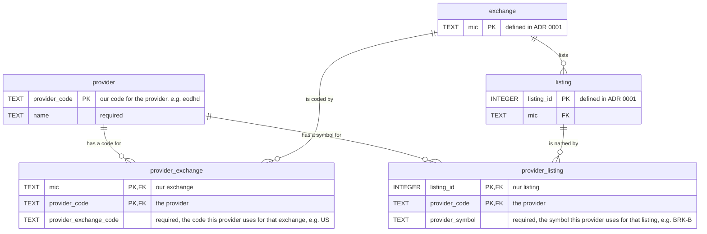

# ADR 0002: Provider identifiers live in mapping tables

- Status: Accepted
- Date: 2026-11-20

## Decision

A data provider has its own names for things: its own code for each exchange and its own symbol for each listing. Those names never go into the core tables of ADR 0001. They live in mapping tables, one row per provider and core row.

| Table | One row is |
|---|---|
| `provider` | A data provider, such as EODHD |
| `provider_exchange` | The code one provider uses for one of our exchanges |
| `provider_listing` | The symbol one provider uses for one of our listings |

A view, `provider_listing_address`, puts the two together so a request to the provider can be built.

## Diagram



`PK` is a primary key, `FK` a foreign key. `exchange` and `listing` are the core tables of ADR 0001, shown with their keys only.

## Tables

How to read the tables below:

- **Key**: `PK` is the primary key; where two columns are marked `PK`, the pair is the key. `FK → table.column` is a foreign key to that column.
- **Required**: every column in these tables is required. A missing fact is a missing row, never an empty column.

### `provider`

One row per data provider.

| Column | Type | Key | Required | Constraint | Meaning |
|---|---|---|---|---|---|
| `provider_code` | TEXT | PK | yes | Starts with a lower-case letter; lower-case letters, digits and underscores only | pyvalue's own short code for the provider |
| `name` | TEXT | | yes | Not empty, no leading or trailing spaces | The provider's name |

Example row:

| `provider_code` | `name` |
|---|---|
| `eodhd` | EODHD |

Note:

- **`provider_code` is the primary key.** pyvalue assigns it, so it is stable and meaningful and no numeric id is needed.

### `provider_exchange`

One row says: this provider uses this code for this exchange of ours.

| Column | Type | Key | Required | Constraint | Meaning |
|---|---|---|---|---|---|
| `mic` | TEXT | PK, FK → `exchange.mic` | yes | The exchange must exist | Our exchange |
| `provider_code` | TEXT | PK, FK → `provider.provider_code` | yes | The provider must exist | The provider |
| `provider_exchange_code` | TEXT | | yes | Not empty, no leading or trailing spaces | The code the provider itself uses for that exchange, in its own requests and responses |

Example rows:

| `mic` | `provider_code` | `provider_exchange_code` | Read as |
|---|---|---|---|
| `XNYS` | `eodhd` | `US` | EODHD calls the New York Stock Exchange `US` |
| `XNAS` | `eodhd` | `US` | EODHD calls Nasdaq `US` as well |
| `XETR` | `eodhd` | `XETRA` | EODHD calls Xetra `XETRA` |
| `XKOS` | `eodhd` | `KQ` | EODHD calls KOSDAQ `KQ` |

There is no row for `XJPX`: EODHD does not serve Tokyo.

Notes:

- **The key is the pair `mic` plus `provider_code`**: a provider has at most one code for an exchange.
- **`provider_exchange_code` is not unique.** Several of our exchanges can share one provider code, as New York and Nasdaq do above.
- **No row means the provider does not serve that exchange.**
- **If a provider splits a market finer than we do**, the exchange row is split under the rule in ADR 0001. The mapping is not bent to fit.

### `provider_listing`

One row says: this provider uses this symbol for this listing of ours.

| Column | Type | Key | Required | Constraint | Meaning |
|---|---|---|---|---|---|
| `listing_id` | INTEGER | PK, FK → `listing.listing_id` | yes | The listing must exist | Our listing |
| `provider_code` | TEXT | PK, FK → `provider.provider_code` | yes | The provider must exist | The provider |
| `provider_symbol` | TEXT | | yes | Not empty, no leading or trailing spaces | The symbol the provider itself uses for that listing, without any exchange part |

Example rows:

| `listing_id` | `provider_code` | `provider_symbol` | Read as |
|---|---|---|---|
| 1 (Berkshire B, ticker `BRK.B`) | `eodhd` | `BRK-B` | EODHD calls Berkshire's B share `BRK-B` |
| 2 (Alphabet A, ticker `GOOGL`) | `eodhd` | `GOOGL` | EODHD calls Alphabet's A share `GOOGL` |
| 4 (SAP, ticker `SAP`) | `eodhd` | `SAP` | EODHD calls SAP `SAP` |

Notes:

- **The key is the pair `listing_id` plus `provider_code`**: a provider has at most one symbol for a listing.
- **`provider_symbol` is stored exactly as the provider gives it.** It is never derived from `listing.ticker`, because the two can differ, as for Berkshire above.
- **No row means the listing is not mapped at that provider.**

### `provider_listing_address` (view)

One row gives the two parts a provider needs to address one listing. It stores nothing; it joins the tables above.

| Column | Comes from | Meaning |
|---|---|---|
| `provider_code` | `provider_listing` | The provider |
| `listing_id` | `provider_listing` | Our listing |
| `provider_symbol` | `provider_listing` | The provider's symbol for the listing |
| `provider_exchange_code` | `provider_exchange`, for the exchange the listing trades on | The provider's code for the listing's exchange |

Worked example, for EODHD, whose requests take the form `SYMBOL.EXCHANGE`:

| Listing | Trades on | `provider_symbol` | `provider_exchange_code` | Request sent to EODHD |
|---|---|---|---|---|
| Berkshire B | `XNYS` | `BRK-B` | `US` | `BRK-B.US` |
| Alphabet A | `XNAS` | `GOOGL` | `US` | `GOOGL.US` |
| SAP | `XETR` | `SAP` | `XETRA` | `SAP.XETRA` |
| Toyota | `XJPX` | (none) | (none) | No row in the view, so no request |

Notes:

- **The provider's client code formats the two parts.** The dot between them is EODHD's convention, not part of the schema.
- **No stand-in lines.** The exchange part always comes from the exchange the listing trades on. A listing on an exchange the provider does not serve has no row in the view, even if a symbol was stored for it, so a Tokyo listing can never be fetched through a Frankfurt line.

### Rules for all three tables

| Rule | What it means |
|---|---|
| Absence is a missing row | No column in these tables can be empty. |
| Nothing is deleted implicitly | A listing, exchange or provider that still has mappings cannot be deleted. |
| A changed `mic` or `provider_code` follows through | If either code is corrected, the mapping rows are updated with it. |

### What the schema does not enforce

| Not enforced | Consequence |
|---|---|
| That two listings do not share a provider line | Two listings on different exchanges with the same provider code (`XNYS` and `XNAS` under `US`) could be given the same symbol. A data-quality check has to catch that. |
| That a stored symbol can be addressed | A `provider_listing` row for an exchange the provider does not serve is accepted. It is inert: the view returns nothing for it. |
| That a symbol is the right one | The schema stores what the mapping step found. |

## Indexes

| Index | Created by | Query it serves |
|---|---|---|
| `provider_exchange (mic, provider_code)` | The primary key | The provider's code for a listing's exchange; the foreign-key check when an exchange is deleted |
| `provider_listing (listing_id, provider_code)` | The primary key | The provider's symbol for a listing; the foreign-key check when a listing is deleted |

Each primary key leads with the core table's column, so the index serves lookups that start from a listing or an exchange. No further index is added. Reading every mapping of one provider scans `provider_listing`, which is the whole table while there is one provider. `provider_exchange` has a few dozen rows.

## Normalisation

All three tables are in Boyce-Codd normal form, with no deliberate deviation. In each mapping table the one non-key column depends on the whole key. Storing the bare symbol keeps a provider's exchange code in one place; a full identifier such as `BRK-B.US` on every listing row would repeat it.

## Why this design

pyvalue gets prices and fundamentals from data providers. EODHD is the first, and it is one of several the framework may use.

EODHD addresses a stock as `SYMBOL.EXCHANGE`, and both parts are EODHD's own:

| Part | Why it is not ours |
|---|---|
| Exchange | It is not a market code. `US` is one code for every US venue. |
| Symbol | It is not always the exchange's ticker. Share classes take a hyphen and dots are not allowed, so Berkshire's B share is `BRK-B`. |

The author's decision: the core tables stay independent of any provider. There is a `provider` table with a primary key, and any provider-specific value for any field lives in a separate table.

## Evidence

- **EODHD's exchange codes map cleanly to market codes.** The legacy database holds 65 EODHD stock-exchange codes with the market codes EODHD publishes for them (catalogue of 2026-07-11). 64 map to exactly one market code. `US` covers four: `XNAS`, `XNYS`, `OTCM` and `XCBO`.
- **EODHD distinguishes KOSPI (`KO`) from KOSDAQ (`KQ`)**, which is why ADR 0001 gives KOSDAQ its own exchange row.
- **EODHD's symbol format** (hyphen for share classes, no dots, `US` as one code) is from its documentation, read on 2026-11-20.
- **The schema was exercised in a scratch SQLite database** on 2026-11-20: valid rows were accepted, 25 invalid statements were each rejected by the intended constraint, and the view returned no row for a listing on an unserved exchange.

## Consequences

- **A second provider is new rows, not a schema change.**
- **Coverage is a query.** Exchanges without a `provider_exchange` row are the markets a provider does not serve. Listings without a `provider_listing` row are the ones not yet mapped.
- **The reason a listing is unmapped is not recorded.** "Not looked up yet" and "looked up and not found" are both a missing row.
- **Building a request needs a join**, which the view provides.
- **A provider's exchange catalogue is not modelled.** The schema records what a provider calls our exchanges, not the full list of exchanges the provider offers.

## Alternatives considered

| Alternative | Why not |
|---|---|
| Nullable provider columns on the core tables (`exchange.eodhd_code`, `listing.eodhd_symbol`) | Rejected by the author: it ties the core tables to one provider. |
| Storing the provider's full identifier (`BRK-B.US`) on `provider_listing` | It would let a listing be pointed at a line on another exchange, and it repeats the exchange code on every row. |
| Modelling the provider's own exchanges as an entity, as in legacy, with provider listings beneath them | It needs a further table to link one provider exchange to several of ours, with no present use. |

## Not decided here

- How a listing's symbol at a provider is found. EODHD documents a search by ISIN and an identifier-mapping endpoint; neither has been called.
- A mapping for providers that identify companies and not listings (the SEC's company number, for example). It would be a further table of the same shape, added when a provider needs it.
- Raw provider payloads, fetch state and the provider client code.

## Appendix: SQL

The exact statements, for SQLite. They say the same as the tables above.

```sql
CREATE TABLE provider (
    provider_code TEXT NOT NULL PRIMARY KEY
                  CHECK (provider_code GLOB '[a-z]*' AND provider_code NOT GLOB '*[^a-z0-9_]*'),
    name          TEXT NOT NULL CHECK (name <> '' AND name = trim(name))
);

CREATE TABLE provider_exchange (
    provider_code TEXT NOT NULL REFERENCES provider (provider_code) ON UPDATE CASCADE ON DELETE RESTRICT,
    mic           TEXT NOT NULL REFERENCES exchange (mic) ON UPDATE CASCADE ON DELETE RESTRICT,
    provider_exchange_code TEXT NOT NULL CHECK (provider_exchange_code <> '' AND provider_exchange_code = trim(provider_exchange_code)),
    PRIMARY KEY (mic, provider_code)
);

CREATE TABLE provider_listing (
    provider_code TEXT NOT NULL REFERENCES provider (provider_code) ON UPDATE CASCADE ON DELETE RESTRICT,
    listing_id    INTEGER NOT NULL REFERENCES listing (listing_id) ON DELETE RESTRICT,
    provider_symbol TEXT NOT NULL CHECK (provider_symbol <> '' AND provider_symbol = trim(provider_symbol)),
    PRIMARY KEY (listing_id, provider_code)
);

CREATE VIEW provider_listing_address AS
SELECT pl.provider_code, pl.listing_id, pl.provider_symbol, pe.provider_exchange_code
FROM provider_listing AS pl
JOIN listing AS l ON l.listing_id = pl.listing_id
JOIN provider_exchange AS pe ON pe.mic = l.mic AND pe.provider_code = pl.provider_code;
```
