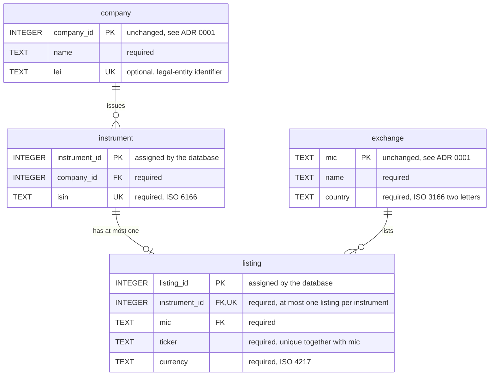

# ADR 0003: An instrument table between company and listing

- Status: Accepted
- Date: 2026-11-20
- Supersedes: the `listing` table of ADR 0001. The `exchange` and `company` tables of ADR 0001 stand, and so does all of ADR 0002.

## Decision

A security and the place it trades are two facts, learned at different times. A fund's holdings filing names the security (its ISIN) and the company. Where the security trades is found later, by a lookup, and for some securities it is never found. So the ISIN moves out of `listing` into a table of its own.

| Table | One row is | Compared with ADR 0001 |
|---|---|---|
| `exchange` | A market on which companies list | Unchanged |
| `company` | A legal entity that issues securities | Unchanged |
| `instrument` | One security of a company, identified by its ISIN | New |
| `listing` | The primary exchange line of an instrument | Changed: it points at an instrument, not at a company, and no longer holds the ISIN |

A company has one or more instruments. An instrument has no listing or one listing. A listing trades on exactly one exchange.

## Diagram



`PK` is a primary key, `FK` a foreign key, `UK` a unique column.

## Tables

How to read the tables below:

- **Key**: `PK` is the primary key. `FK → table.column` is a foreign key to that column. `UNIQUE` means no two rows share the value.
- **Required**: `yes` means the column can never be empty.

`exchange` and `company` are exactly as ADR 0001 defines them and are not repeated here.

### `instrument`

One row per security of a company.

| Column | Type | Key | Required | Constraint | Meaning |
|---|---|---|---|---|---|
| `instrument_id` | INTEGER | PK | yes | Assigned by the database, never reused | pyvalue's own id for the security |
| `company_id` | INTEGER | FK → `company.company_id` | yes | The company must exist | The company that issued the security |
| `isin` | TEXT | UNIQUE | yes | 12 characters: two letters, nine letters or digits, one digit | The security's ISO 6166 identifier |

Example rows:

| `instrument_id` | `company_id` | `isin` |
|---|---|---|
| 1 | 1 (Berkshire Hathaway) | `US0846707026` |
| 2 | 2 (Alphabet) | `US02079K3059` |
| 3 | 2 (Alphabet) | `US02079K1079` |
| 4 | 3 (SAP) | `DE0007164600` |
| 5 | 4 (Toyota) | `JP3633400001` |

Notes:

- **An instrument exists as soon as a holdings source names it.** It needs no exchange and no ticker.
- **Several instruments per company.** A company has one row per security, each with its own ISIN: Alphabet's two share classes above, a common and a preferred share, or a Chinese company's mainland and Hong Kong shares.
- **`instrument_id` is a surrogate key.** The ISIN is unique but can change after a corporate action. When it changes, the row is updated and `instrument_id` stays the same.
- **`isin` is unique**, so the same security can never be entered twice, however many exchanges it trades on.

### `listing`

One row per instrument that has a known primary exchange line.

| Column | Type | Key | Required | Constraint | Meaning |
|---|---|---|---|---|---|
| `listing_id` | INTEGER | PK | yes | Assigned by the database, never reused | pyvalue's own id for the listing |
| `instrument_id` | INTEGER | UNIQUE, FK → `instrument.instrument_id` | yes | The instrument must exist; no two listings share an instrument | The security that trades on this line |
| `mic` | TEXT | FK → `exchange.mic` | yes | The exchange must exist | The exchange the security trades on |
| `ticker` | TEXT | UNIQUE together with `mic` | yes | Not empty, no leading or trailing spaces, upper case | The exchange's own ticker for the security |
| `currency` | TEXT | | yes | Exactly three upper-case letters | The ISO 4217 currency the security trades in |

Example rows:

| `listing_id` | `instrument_id` | `mic` | `ticker` | `currency` |
|---|---|---|---|---|
| 1 | 1 (Berkshire B, `US0846707026`) | `XNYS` | `BRK.B` | `USD` |
| 2 | 2 (Alphabet A, `US02079K3059`) | `XNAS` | `GOOGL` | `USD` |
| 3 | 3 (Alphabet C, `US02079K1079`) | `XNAS` | `GOOG` | `USD` |
| 4 | 4 (SAP, `DE0007164600`) | `XETR` | `SAP` | `EUR` |

There is no row for instrument 5 (Toyota): its listing has not been found. The instrument is still in the database.

Notes:

- **Primary listing only.** A row is the line on the market where the instrument has its primary listing. Because `instrument_id` is unique here, an instrument has at most one listing, so there is no primary/secondary status column.
- **No listing is a missing row.** An instrument whose exchange and ticker are unknown simply has no `listing` row. No column is left empty to say so.
- **`listing_id` stays the key that other tables point at.** `provider_listing` (ADR 0002) references it unchanged.
- **The company of a listing is reached through its instrument.** `listing` has no `company_id` of its own.
- **`ticker` and `currency` mean what they meant in ADR 0001**: the exchange's own ticker, and the trading currency (not a quote unit).

## What changes from ADR 0001

| ADR 0001 said | Now |
|---|---|
| `listing.isin`, unique: one row per security | `instrument.isin`, unique. `listing.instrument_id`, unique: at most one listing per security |
| `listing.company_id` | `instrument.company_id`. A listing reaches its company through its instrument |
| A line whose ticker or exchange cannot be found is not loaded | It is loaded as an instrument without a listing |
| Several listings per company | Several instruments per company, each with at most one listing |
| A depositary receipt gets a row only when it is the company's own primary listing | A receipt becomes an instrument only when its company has no other line in the universe (ADR 0006). Whether it then gets a listing is decided by ADR 0005 |
| "A separate table for the security" was rejected as not needed | It is adopted, for a reason ADR 0001 did not weigh: a security is known before its listing is |
| Index `listing_company_id` | Index `instrument_company_id` |

Where ADR 0002 says its core tables are those of ADR 0001, read `listing` as defined here. Nothing in ADR 0002 changes: it uses only `listing.listing_id` and `listing.mic`.

## Rules

The rules of ADR 0001 carry over to all four tables.

| Rule | What it means |
|---|---|
| ISO identifiers only | The tables hold standard identifiers and nothing that belongs to one provider. |
| Ids are never reused | A deleted row's id is never given to a new row. |
| Nothing is deleted implicitly | A company that still has instruments cannot be deleted. An instrument that still has a listing cannot be deleted. An exchange that still has listings cannot be deleted. |
| A changed `mic` follows through | If an exchange's code is corrected, its listings are updated with it. |
| Check digits are validated in code | The constraint enforces the shape of an ISIN. Its check digit is validated by the code that writes the row. |
| Foreign keys are switched on | The database is opened with `PRAGMA foreign_keys = ON`. |

## What the schema does not enforce

| Not enforced | Who guards it |
|---|---|
| That the stored line is the instrument's home line | The step that fills listings (ADR 0005). The schema only guarantees at most one line per instrument. |
| Why an instrument has no listing | Not the schema: all three reasons are a missing row. A decided "no listing" is in the decisions file of ADR 0005. "Home market not served" is recomputed by the rule of ADR 0005. An instrument with neither has not been decided yet. |
| That an instrument is a share, and not a receipt, a fund or a right | The load (ADR 0006) keeps most receipts out; the agent of ADR 0005 decides the rest |
| That a company without a legal-entity identifier is entered once | The load (ADR 0006), by exact name |
| That a company has at least one instrument | Nothing |

## Indexes

| Index | Created by | Query it serves |
|---|---|---|
| `instrument (isin)` | The `UNIQUE` constraint | Find an instrument by ISIN when holdings are loaded |
| `instrument (company_id)` | `instrument_company_id` | List a company's instruments; check the foreign key when a company is deleted |
| `listing (instrument_id)` | The `UNIQUE` constraint | Find the listing of an instrument; list the instruments that have none; check the foreign key when an instrument is deleted |
| `listing (mic, ticker)` | The `UNIQUE` constraint | Resolve an exchange and ticker typed by a person; list the listings on an exchange |

There is no separate index on `listing (mic)`: it is the leading column of the (`mic`, `ticker`) index.

## Normalisation

All four tables are in Boyce-Codd normal form, with no deliberate deviation. In `instrument`, the company depends on the security and on nothing else. In `listing`, every column depends on the instrument, and the company is not repeated: it is stored once, on the instrument.

## Why this design

- **The holdings source does not say where a security trades.** The SEC filings chosen in ADR 0004 carry an ISIN on practically every equity line and an exchange on none. Under ADR 0001, `mic` and `ticker` were required, so nothing could be stored until a lookup had succeeded.
- **Some securities will never get a listing at the first provider.** They still belong to the universe and have to be reported, which needs a row to report.
- **The universe should not depend on a provider.** Instruments come from the funds. Listings are filled by whichever provider can resolve them, so a second provider can later fill what the first could not.
- **The author proposed the table** on 2026-11-20, as the first half of a two-step method: load instruments from the funds, then fill listings by lookup, with an agent deciding the unclear cases (ADR 0005).

## Evidence

Measured on 2026-11-20 on the latest public SEC holdings filings of the three funds of ADR 0004.

- **What a holdings line identifies.** Of 22,820 lines for shares, units, rights and receipts, 22,764 carry a valid ISIN. None carries an exchange, and one carries a ticker.
- **Securities without a findable listing.** The load of ADR 0006 gives 15,979 instruments. With the legacy EODHD catalogue (refreshed 2026-07-11) standing in for a lookup, 3,222 of them have no line at all and trade in a country where EODHD has no exchange: Japan 1,250, India 992, Turkey 213, Hong Kong 212, Saudi Arabia 150, Israel 149, and others. Under ADR 0001 none of these could be stored.
- **The schema was exercised in a scratch SQLite database** (version 3.53.2). Valid rows were accepted, including instruments without a listing. 25 invalid statements were each rejected by the intended constraint: a repeated ISIN, a malformed ISIN, an unknown company, a second listing for one instrument, a repeated exchange and ticker, and deletions that would leave an orphan. The queries in the index table above each used the index named there. The view of ADR 0002 returned the same rows as before.

## Consequences

- **The universe is the set of instruments.** The set that can be screened is the instruments that have a listing.
- **"Excluded and reported" is a query**: the instruments without a listing.
- **Finding a listing by ISIN, or a listing's company, takes one more join** than under ADR 0001.
- **Storing secondary listings later is a small change.** Dropping the `UNIQUE` on `listing.instrument_id` allows it, and no other table is re-keyed. ADR 0001 expected this to need a new table.
- **ADR 0002 is unaffected.**
- **Nothing has to be migrated.** No code or database implements ADR 0001 yet.

## Alternatives considered

| Alternative | Why not |
|---|---|
| Keep ADR 0001: the ISIN on `listing` | A security cannot be stored until its exchange and ticker are known, and a security in a market no provider serves has no place at all. |
| One table, with `mic`, `ticker` and `currency` allowed to be empty | Three columns that must be empty together or filled together. Absence is clearer as a missing row, the rule ADR 0002 already follows. |
| `instrument_id` as the primary key of `listing` | It would re-key `provider_listing` (ADR 0002), and would have to be undone if secondary listings are ever stored. |
| ISIN as the primary key of `instrument` | ISINs change, and every table that references an instrument would have to follow. |
| `listing` keeps its own `company_id` | The same fact in two places. |

## Not decided here

- Which funds supply the instruments (ADR 0004), how their holdings are loaded and grouped into companies (ADR 0006), and how a listing is found (ADR 0005).
- A type for the instrument (common share, preferred share, receipt).
- Prices, quote units and fundamentals.
- Where migrations live. The per-table documentation under `docs/database/` is written with the implementation.

## Appendix: SQL

The exact statements for the new and the changed table, for SQLite. They say the same as the tables above. `exchange` and `company` are as in ADR 0001.

```sql
CREATE TABLE instrument (
    instrument_id INTEGER PRIMARY KEY AUTOINCREMENT,
    company_id    INTEGER NOT NULL REFERENCES company (company_id) ON DELETE RESTRICT,
    isin          TEXT NOT NULL UNIQUE
                  CHECK (length(isin) = 12 AND isin NOT GLOB '*[^A-Z0-9]*' AND isin GLOB '[A-Z][A-Z]*[0-9]')
);

CREATE INDEX instrument_company_id ON instrument (company_id);

CREATE TABLE listing (
    listing_id    INTEGER PRIMARY KEY AUTOINCREMENT,
    instrument_id INTEGER NOT NULL UNIQUE REFERENCES instrument (instrument_id) ON DELETE RESTRICT,
    mic           TEXT NOT NULL REFERENCES exchange (mic) ON UPDATE CASCADE ON DELETE RESTRICT,
    ticker        TEXT NOT NULL CHECK (ticker <> '' AND ticker = trim(ticker) AND ticker = upper(ticker)),
    currency      TEXT NOT NULL CHECK (currency GLOB '[A-Z][A-Z][A-Z]'),
    UNIQUE (mic, ticker)
);
```
