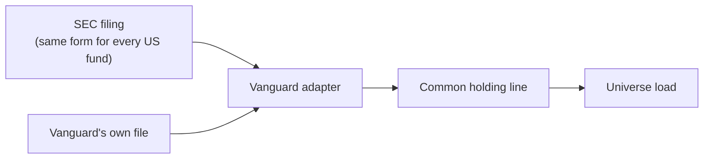

# ADR 0016: The universe comes from Vanguard's two funds, read through a sponsor adapter

- Status: Accepted. ADR 0020 adds the sponsor's own name for the security to the common holding line.
- Date: 2026-11-26
- Supersedes: ADR 0004. It also changes two points of other records: the funds read in step 1 of ADR 0006, and the documents that ADR 0009 pins and downloads. The loading rules of ADR 0006 and the decision files of ADR 0010 to ADR 0015 stand.

## Decision

pyvalue's stock universe is the set of securities held by two Vanguard funds. Each fund is read from two documents, and the code that knows a fund company's documents sits behind an adapter.

| Point | Decision |
|---|---|
| Funds | Vanguard Total Stock Market Index Fund (VTI, scope US) and Vanguard Total International Stock Index Fund (VXUS, scope non-US). The Dimensional fund DFAX of ADR 0004 is removed |
| Base document | The fund's holdings filing at the US Securities and Exchange Commission (form N-PORT). It decides what is in the universe |
| Second document | The fund company's own holdings file. It adds a ticker and a SEDOL to the lines of the filing, joined by ISIN |
| Join rule | Ticker and SEDOL are attached to a line only when its ISIN has exactly one line in the filing and exactly one row in the fund company's file. Otherwise both stay empty |
| Adapter | One adapter per fund company (sponsor) turns that sponsor's documents into one common holding line. The load sees only the common line |
| Meaning of the country | The adapter says which country a line trades in. For Vanguard that is the country the filing gives |
| Guard on that meaning | The Vanguard adapter stops the load when the filed country and the country of the trading currency disagree on more than 2% of the lines held in a currency other than the euro. Today they disagree on 0.5% |

## The two documents

What each document gives for a share line. Fill counts are for VTI and VXUS, from the filings of 30 June and 31 July 2026 and from Vanguard's file of 31 October 2026.

| Field | SEC filing | Vanguard's own file |
|---|---|---|
| ISIN | 3,502 of 3,546 lines / 8,762 of 8,868 | 3,472 of 3,475 rows / 8,844 of 8,860 |
| Issuer name and security title | Every line | A long and a short name on every row |
| Company identifier (LEI) | A real one on about 72% / 65% of lines | Not given |
| CUSIP (US security number) | A real one on about 99% / 8% of lines | 3,473 / 774 rows |
| Asset category (common, preferred) | Every line | Not given |
| Issuer type (company, registered fund) | Every line | Not given |
| Country | Every line | Not given |
| Trading currency | Every line | Not given |
| Ticker | Never on a share line | 3,455 / 8,491 rows |
| SEDOL | Not given | 3,472 / 8,860 rows |
| Exchange | Not given | Not given |

The filing also gives the number of shares, the value and the share of the fund. Those are not used.

Where the documents come from:

| Document | Address | Kept |
|---|---|---|
| SEC filing | The permanent address of the pinned filing, as in ADR 0009 | `data/sec/` |
| Vanguard's file | `https://investor.vanguard.com/vmf/api/{fund id}/portfolio-holding/stock.json`, read 500 rows at a time. Fund ids: `0970` for VTI, `3369` for VXUS. The address is not documented by Vanguard | `data/vanguard/` |

Neither folder is committed. The SEC contact line of ADR 0009 is sent to `www.sec.gov` only, never to Vanguard.

## The adapter

An adapter is a translator: it reads one fund company's documents and hands the load the same kind of line whatever the company. To use another fund company later, such as iShares, a second adapter is written and the load stays as it is.

| Part | What it is | Shared or per sponsor |
|---|---|---|
| The reader of the SEC form | Reads a filing into lines. Every US-registered fund files the same form | Shared |
| The reader of the sponsor's file | Reads Vanguard's file into rows | Vanguard only |
| The adapter | Joins the two, says what the country means, checks the guard above | One per sponsor |
| The common holding line | What the load receives: fund, line number, ISIN, issuer name, title, LEI, CUSIP, asset category and its label, issuer type, trading country, trading currency, ticker, SEDOL | Shared |

A fund's definition names its sponsor, and the sponsor selects the adapter. The definition also carries the fund's scope, which until now existed only in the text of ADR 0004.

## Evidence

Measured on 2026-11-26.

### What the country in a Vanguard filing means

The form asks for one country per line. Whether a sponsor fills in where the security trades or where the company is registered is the sponsor's habit.

| Finding | Measurement |
|---|---|
| VXUS: the country is the country of the trading currency | 8,070 of 8,114 lines held in a currency other than the euro |
| VXUS: lines where the security is registered in one country and trades in another | 600. The country follows the trading place on 563, the registration on 34, neither on 3 |
| The 37 apparent exceptions are trading places too | Shanghai and Shenzhen B shares quoted in US or Hong Kong dollars are filed as China. DFI Retail, registered in Bermuda and quoted in US dollars in Singapore, is filed as Singapore. State Bank of India's receipt, quoted in US dollars in London, is filed as the United Kingdom |
| VXUS: the 643 lines held in euros | The country differs from the ISIN's country on 48, such as ArcelorMittal: registered in Luxembourg, filed as the Netherlands, where it trades |
| VTI | 3,501 of 3,502 lines say United States, including 106 companies registered abroad |
| Dimensional files the other way | In DFAX the country follows the ISIN on 10,291 of 10,321 lines. This is why the meaning belongs to the adapter |

### How good Vanguard's tickers are

The legacy EODHD catalogue of October 2026 stands in for the provider's lists.

| Finding | Measurement |
|---|---|
| Securities of the two funds that get a ticker from Vanguard's file | 11,601 of 12,169 |
| Where the ISIN already identifies one line at the provider, the ticker alone finds | The same line 7,298 times, a different line 13 times, several lines 21 times, nothing 124 times |
| Where the ticker finds nothing | 94 of the cases are Malaysian: Vanguard gives a letter code (`MAYBANK`), the provider a number (`1155`) |

### Other sponsors' files, for comparison

| File | Finding |
|---|---|
| Dimensional's daily file for DFAX | Ticker with a two-letter market code, ISIN and SEDOL, but the ticker column is cut at eight characters |
| iShares' file for its international fund | Ticker, exchange name, country and currency, but no ISIN |

### What removing DFAX costs

Estimated from the database of 2026-11-22, which holds 15,955 securities of 15,607 companies. A rebuild gives the exact figures.

| Finding | Measurement |
|---|---|
| Securities that stay | About 12,200, of about 11,900 companies |
| Securities that go | About 3,770, held only by DFAX. Mostly small companies: Taiwan 540, Japan 495, Korea 424, India 340, mainland China 278, Hong Kong 222, Thailand 177 |
| Of those, in a market the first provider serves | About 2,400 |
| Receipts that change sides | One. 32 VXUS receipts are left out today because the company's own share is held. For 31 a Vanguard fund holds that share. For Tencent Music only DFAX did, so its receipt becomes the company's only line |

## Why this design

- **The author's decisions.** Use Vanguard's funds only. Start from the SEC filings, then add ticker and SEDOL from Vanguard's own file. Keep every identifier the documents give. Put the sponsor behind an adapter so the funds can be changed later.
- **The filing is the better base.** It is a permanent, numbered document with the company identifier, the trading currency, the country and the category of every line. Vanguard's file has none of those and shows only the latest month.
- **Vanguard's file is the only source of a ticker.** The filing has none, and the provider's lists carry no ISIN on a quarter to a third of their lines (ADR 0019 uses the ticker there).
- **The strict join rule keeps a ticker a fact of its line.** A security held on two markets has a SEDOL for each and can have a ticker for each, and neither document says which row belongs to which line. Barrick has three lines in the VXUS filing and three rows in Vanguard's file. Pairing only one line with one row never puts a ticker or a SEDOL on the wrong line.

## Consequences

- **The universe is smaller,** by the figures above. The loss is almost entirely small non-US companies.
- **The database has to be rebuilt,** because the load never deletes.
- **Rows of the decision files that concern only DFAX are removed.**

| File | Rows today | Rows that stay | Why |
|---|---|---|---|
| `lei.csv` | 14 | 0 | Every row settled a disagreement between DFAX and VXUS. With one sponsor the funds do not disagree |
| `name.csv` | 47 | 47 | Every row is about a security a Vanguard fund holds. Corrected on 2026-11-26: this record first said 46, counting out Pony AI, whose row is keyed by the ordinary share that VXUS's receipt is read as |
| `excluded.csv` | 18 | 13 | Six securities are held only by DFAX. One row is added for Tencent Music's receipt (below) |
| `ordinary_share.csv` | 26 | 15 | Eleven receipts are held only by DFAX |

- **The mechanisms of ADR 0010 to ADR 0015 stay,** including the empty identifier file, for the day a second sponsor is added.
- **Tencent Music is kept out.** Decided by the author on 2026-11-26. Its New York receipt (`US88034P1093`) gets a row in `excluded.csv` at the rebuild, under ADR 0013. Its Hong Kong share was held only by DFAX, so the company leaves the universe.
- **Vanguard's file cannot be fetched again for a past month.** A rebuild later reads a later file. That can change a ticker or a SEDOL; it never changes which securities are in the universe.
- **The two documents have different dates.** A security in the filing that has left the fund by the date of Vanguard's file gets no ticker.
- **An undocumented address can move.** If Vanguard's file cannot be read, the load of a Vanguard fund stops; it does not go on without tickers.
- **The filings are as old as before:** two to five months, as in ADR 0004.

## Alternatives considered

| Alternative | Why not |
|---|---|
| Keep the three funds of ADR 0004 | Rejected by the author: one familiar sponsor and one kind of sponsor file are simpler. DFAX can be added back through its own adapter without a schema change |
| Vanguard's own file as the base document | It has no company identifier, currency, country or category, and it cannot be fetched again for a past month |
| iShares funds, whose file gives ticker and exchange | The file has no ISIN, and the two broadest funds hold about 7,000 companies |
| Attach a ticker whenever the ISIN matches | A security held on two markets would carry one market's ticker on both lines |
| A table of its own for the sponsor's rows | It would shape the schema after Vanguard's file. The common line keeps the schema the same for every sponsor |

## Not decided here

- Which filings are pinned at the rebuild. Newer ones are due: VTI's holdings of 30 September 2026 and VXUS's of 31 October 2026.
- The adapter for any other sponsor.
- The tables that store funds and holding lines (ADR 0017).
- How a listing is found for each security (ADR 0019).
