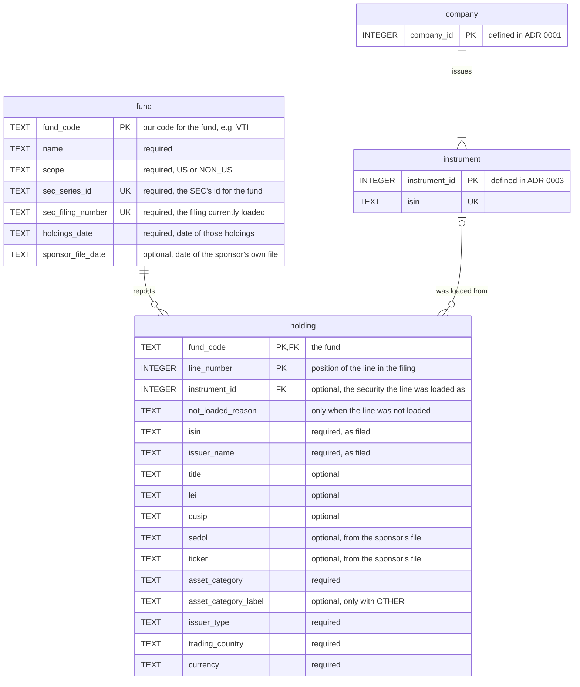

# ADR 0017: Funds and their holding lines are stored

- Status: Accepted. ADR 0021 supersedes one part: a line that was not loaded is no longer stored, so `holding` has no `not_loaded_reason` column and `instrument_id` is required. ADR 0022 supersedes another: the columns `asset_category_label` and `issuer_type` are removed.
- Date: 2026-11-26
- Supersedes: the decision of ADR 0006 that there is no table for funds and none for holdings lines. The loading rules of ADR 0006 stand: how a line finds its company, the receipt check, and that a company or an instrument is never deleted.

## Decision

The funds of ADR 0016 and the share lines of their holdings filings get two tables.

| Table | One row is |
|---|---|
| `fund` | A fund whose holdings are loaded |
| `holding` | One share line of that fund's loaded filing: what the fund's documents say about it |

A holding row records the source. It holds nothing pyvalue decided, except which instrument the line was loaded as.

## Diagram



`PK` is a primary key, `FK` a foreign key, `UK` a unique column. `instrument` and `company` are the tables of ADR 0003 and ADR 0001, shown with their keys only.

## Tables

How to read the tables below:

- **Key**: `PK` is the primary key; where two columns are marked `PK`, the pair is the key. `FK → table.column` is a foreign key to that column. `UNIQUE` means no two rows share the value.
- **Required**: "yes" means the column can never be empty. "no" means an empty value is a valid state, and the Meaning column says what it stands for.
- **From**: which document the value comes from (ADR 0016). "SEC" is the holdings filing, "Sponsor" the fund company's own file, "Adapter" the sponsor's adapter.

### `fund`

One row per fund whose holdings are loaded.

| Column | Type | Key | Required | Constraint | Meaning |
|---|---|---|---|---|---|
| `fund_code` | TEXT | PK | yes | Upper-case letters and digits only | pyvalue's own code for the fund: its ticker |
| `name` | TEXT | | yes | Not empty, no leading or trailing spaces | The fund's name |
| `scope` | TEXT | | yes | `US` or `NON_US` | Whether the fund is expected to hold US-coded ISINs. ADR 0019 reads it to find depositary receipts |
| `sec_series_id` | TEXT | UNIQUE | yes | `S` followed by nine digits | The SEC's id for the fund |
| `sec_filing_number` | TEXT | UNIQUE | yes | Ten digits, two digits, six digits, joined by hyphens | The filing whose lines are in `holding` now |
| `holdings_date` | TEXT | | yes | A date written as `YYYY-MM-DD` | The day that filing states the holdings for |
| `sponsor_file_date` | TEXT | | no | A date written as `YYYY-MM-DD` | The day the sponsor's own file states the holdings for. Empty for a sponsor that has no such file |

Example rows:

| `fund_code` | `name` | `scope` | `sec_series_id` | `sec_filing_number` | `holdings_date` | `sponsor_file_date` |
|---|---|---|---|---|---|---|
| `VTI` | Vanguard Total Stock Market Index Fund | `US` | `S000002848` | `0000036405-26-000480` | `2026-06-30` | `2026-10-31` |
| `VXUS` | Vanguard Total International Stock Index Fund | `NON_US` | `S000002932` | `0000736054-26-000275` | `2026-07-31` | `2026-10-31` |

Notes:

- **`fund_code` is the primary key.** pyvalue assigns it, so it is stable and meaningful and no numeric id is needed.
- **One filing per fund.** The table says which filing is loaded now, not which were loaded before.

### `holding`

One row per share line of the loaded filing that carries a valid ISIN.

| Column | Type | Key | Required | From | Constraint | Meaning |
|---|---|---|---|---|---|---|
| `fund_code` | TEXT | PK, FK → `fund.fund_code` | yes | | The fund must exist | The fund that reports the line |
| `line_number` | INTEGER | PK | yes | SEC | Greater than zero | The line's position in the filing, counted from 1 |
| `instrument_id` | INTEGER | FK → `instrument.instrument_id` | no | | The instrument must exist | The security the line was loaded as. Empty when the line was not loaded |
| `not_loaded_reason` | TEXT | | only when `instrument_id` is empty | | `excluded_by_decision` or `receipt_company_already_loaded`; present exactly when `instrument_id` is empty | Why the line was not loaded |
| `isin` | TEXT | | yes | SEC | 12 characters: two letters, nine letters or digits, one digit | The ISIN as filed |
| `issuer_name` | TEXT | | yes | SEC | Not empty, no leading or trailing spaces | The issuer's name as filed |
| `title` | TEXT | | no | SEC | Not empty when present | The security's title. Empty when the filing gives none |
| `lei` | TEXT | | no | SEC | 20 upper-case letters or digits, the last two digits | The issuer's legal-entity identifier. Empty when the filing gives none or a placeholder such as `N/A` |
| `cusip` | TEXT | | no | SEC | Nine characters | The US security number. Empty when the filing gives none or a placeholder |
| `sedol` | TEXT | | no | Sponsor | Seven letters or digits | The London Stock Exchange's security number. Empty when the join rule of ADR 0016 attaches none |
| `ticker` | TEXT | | no | Sponsor | Not empty when present, no leading or trailing spaces | The ticker as the sponsor writes it. Empty when the join rule attaches none |
| `asset_category` | TEXT | | yes | SEC | `EC`, `EP`, `STIV` or `OTHER` | The form's asset category: common share, preferred share, short-term investment vehicle, or the filer's own category |
| `asset_category_label` | TEXT | | no | SEC | Allowed only when `asset_category` is `OTHER` | The filer's own label for that category, such as `ADR` |
| `issuer_type` | TEXT | | yes | SEC | Upper-case letters only | The form's issuer type, such as `CORP` for a company or `RF` for a registered fund |
| `trading_country` | TEXT | | yes | Adapter | Two upper-case letters | The ISO 3166 code of the country the line trades in |
| `currency` | TEXT | | yes | SEC | Three upper-case letters | The ISO 4217 code of the currency the fund holds the line in |

Example rows (columns that are empty in all three are left out):

| `fund_code` | `line_number` | `instrument_id` | `not_loaded_reason` | `isin` | `issuer_name` | `lei` | `sedol` | `ticker` | `asset_category` | `issuer_type` | `trading_country` | `currency` |
|---|---|---|---|---|---|---|---|---|---|---|---|---|
| `VXUS` | 8803 | 5210 (SK Hynix) | | `KR7000660001` | SK hynix Inc | `988400XAIK6XISWQV045` | `6450267` | `000660` | `EC` | `CORP` | `KR` | `KRW` |
| `VXUS` | 3618 | 6034 (Qfin Holdings, ordinary share `KYG8851G1001`) | | `US88557W1018` | Qfin Holdings Inc | `836800R59NKEPDR6I240` | | | `EC` | `CORP` | `US` | `USD` |
| `VXUS` | 6798 | | `excluded_by_decision` | `US9220428588` | Vanguard FTSE Emerging Markets ETF | | | | `EC` | `RF` | `US` | `USD` |

The lines are those of the VXUS filing of 31 July 2026; the instrument ids are made up, and so is which sponsor values are empty. The second row is a depositary receipt read as its ordinary share (ADR 0015): the line keeps the receipt's ISIN, country and currency, and points at the instrument of the ordinary share.

Notes:

- **The key is the pair `fund_code` plus `line_number`.** It is the line's own identity in the filing, so no numeric id is added. Nothing refers to a holding row.
- **`isin` is what the fund filed.** It equals the instrument's ISIN except for a receipt read as its ordinary share. ADR 0019 recognises those lines by the difference.
- **`lei` and `issuer_name` are what the fund filed.** The company's stored identifier and name can differ, where a decision of ADR 0010 or ADR 0012 applies.
- **A placeholder is stored as empty,** never as the text `N/A`.
- **`asset_category` has four values** because the load of ADR 0006 takes only those; a debt or derivative line never becomes a row.
- **`issuer_type` is checked for its shape only.** The list of codes is the SEC's and can grow.

### Which lines get a row

| Line of the filing | Row in `holding` | `instrument_id` |
|---|---|---|
| A share line that the load turns into an instrument, or that names an instrument already there | Yes | The instrument |
| A share line of a security kept out by `excluded.csv` (ADR 0013) | Yes | Empty, reason `excluded_by_decision` |
| A depositary receipt whose company is already in the universe through its own shares (ADR 0006, ADR 0014) | Yes | Empty, reason `receipt_company_already_loaded` |
| A line without a valid ISIN | No. It stays in `lines_not_loaded.csv` (ADR 0009) | |
| A line the filing classifies as debt or as a derivative | No. It stays in `lines_not_loaded.csv` | |

Not stored for any line: the number of shares, the value, and the share of the fund.

## Rules

| Rule | What it means |
|---|---|
| A newer filing replaces the fund's lines | When a fund's pinned filing changes, its `holding` rows are deleted and written again, and its `fund` row is updated, in one transaction |
| Companies and instruments are still never deleted | An instrument whose fund no longer holds it keeps its row and has no holding line |
| Nothing is deleted implicitly | A fund that still has holding lines cannot be deleted, and neither can an instrument a line points at |
| A changed `fund_code` follows through | If the code is corrected, the holding rows are updated with it |
| One repository class per table | `FundRepository` and `HoldingRepository`, under the rules of ADR 0008 |

## What the schema does not enforce

| Not enforced | Consequence |
|---|---|
| That `holding.isin` belongs to the instrument the row points at | It differs by design for a receipt read as its ordinary share. The load is what guarantees the link |
| That `ticker` and `sedol` belong to the line | The join rule of ADR 0016 guarantees it: they are attached only when one line meets one row of the sponsor's file |
| That `trading_country` is right | It is what the sponsor's adapter says. The adapter's guard (ADR 0016) checks it against the trading currency |
| That `lei` passes its check digits | The schema checks the shape. The load checks the digits before it writes |

## Indexes

| Index | Created by | Query it serves |
|---|---|---|
| `fund (fund_code)` | The primary key | Find a fund by its code |
| `fund (sec_series_id)`, `fund (sec_filing_number)` | The unique constraints | Refuse a second fund for one SEC series, or one filing loaded as two funds |
| `holding (fund_code, line_number)` | The primary key | Read or replace the lines of one fund; the foreign-key check when a fund is deleted |
| `holding (instrument_id)` | `CREATE INDEX holding_instrument_id` | The holding lines of a security, read by the listing rule of ADR 0019 for every instrument; the foreign-key check when an instrument is deleted |

No index on `holding.isin`: nothing looks a line up by its filed ISIN.

## Normalisation

`fund` is in Boyce-Codd normal form: every column depends on `fund_code` alone.

`holding` is a record of a source document, and it is in third normal form with one deliberate deviation.

| Point | Reasoning |
|---|---|
| The filed values depend on the line | The ISIN, names, identifiers, category, country and currency are what the fund wrote on that line. They are not copies of pyvalue's own facts: `instrument.isin` and `company.lei` are the facts, and they can differ from what a fund filed |
| Ticker and SEDOL | In the world they belong to a security on a market, not to a line. The join rule of ADR 0016 attaches them only where one line meets one row of the sponsor's file, so within a fund a ticker never appears on two lines of the same security |
| The deviation | A security held by both funds appears on a line of each, so its filed values are stored twice, once per fund. That is accepted because the two are separate statements by separate documents, and a difference between them is information |
| `not_loaded_reason` | It depends on the line and on the decision files. It is stored so the table can say why a line has no instrument without the load's report file |

## Why this design

- **The listing rule needs facts that were only in the filing files.** ADR 0005 already read each line's trading currency and each fund's scope from files that had to be at hand. With ADR 0019 it also needs the country and the ticker.
- **The author asked for the tables,** with every identifier the documents give kept in case it is useful later.
- **One common line for every sponsor.** The table has the shape of the common holding line of ADR 0016, not the shape of one sponsor's file, so another sponsor needs no schema change.
- **Lines that were not loaded are kept** so the table shows everything the fund holds in shares, and why something is not in the universe.

## Evidence

- **The statements were run in a scratch SQLite database** on 2026-11-26, together with those of ADR 0018, on top of migration `0001`. 15 valid statements were accepted and 37 invalid ones were each rejected: a second fund for one filing, a loaded line that also carries a reason, a line that was not loaded and gives no reason, a debt category, a label without the `OTHER` category, placeholders for the ISIN, the identifier and the CUSIP, a date not written as `YYYY-MM-DD`, and deletes of a fund or an instrument that lines still point at.
- **A first draft of the date check let `31/07/2026` through.** A comparison with an empty result passes a check, so the check is written with `IS`.
- **The index is used:** the query plan for "the holding lines of a security" searches `holding_instrument_id`.
- **Lines per security,** measured on the two filings for the securities in today's database: 12,155 have one line, 27 have two and 2 have three. Five securities are held by both funds.

## Consequences

- **The database can say which fund holds a security,** in which country and currency, and under which ticker.
- **The filing files no longer have to be at hand when listings are filled.** That consequence of ADR 0006 ends.
- **The table shows the present, not the history.** Which fund held a security earlier is not recorded.
- **A hand-added instrument has no holding line.** ADR 0019 reports such a security as "not held".
- **A migration adds the two tables.** A database built before it has no rows in them until the load is run again, and the load of ADR 0016 needs a rebuild in any case.
- **`lines_not_loaded.csv` stays** for the lines that get no row: those without a valid ISIN and those the filing classifies as debt or derivatives.

## Alternatives considered

| Alternative | Why not |
|---|---|
| No tables, as in ADR 0006 | The listing rule would keep reading the filing files, and the database could not say why a security is in the universe |
| A numeric id as the key of `holding` | Nothing refers to a holding row, and the fund and line number already identify it |
| Store only the lines that were loaded | The table would hide the receipts and the excluded securities the fund holds |
| A table of its own for the sponsor's rows, keyed by ISIN and SEDOL | It would shape the schema after Vanguard's file. A sponsor whose file has no ISIN would not fit |
| Store the number of shares, the value and the share of the fund | Not wanted by the author, and nothing reads them |
| A `filing` table between `fund` and `holding`, to keep earlier filings | No present use. It can be added when history is wanted |
| List the SEC's issuer types in a check | The list is the SEC's and can grow; a new code would stop a load for no gain |

## Not decided here

- Keeping the lines of earlier filings.
- A security type on `instrument`, which ADR 0003 left open. The asset category is now stored on the line.
- How a listing is found from these lines (ADR 0019).

## Appendix: SQL

The exact statements, for SQLite. They say the same as the tables above. `instrument` is as in ADR 0003.

```sql
CREATE TABLE fund (
    fund_code         TEXT NOT NULL PRIMARY KEY
                      CHECK (fund_code <> '' AND fund_code NOT GLOB '*[^A-Z0-9]*'),
    name              TEXT NOT NULL CHECK (name <> '' AND name = trim(name)),
    scope             TEXT NOT NULL CHECK (scope IN ('US', 'NON_US')),
    sec_series_id     TEXT NOT NULL UNIQUE
                      CHECK (length(sec_series_id) = 10 AND sec_series_id GLOB 'S[0-9]*'
                             AND substr(sec_series_id, 2) NOT GLOB '*[^0-9]*'),
    sec_filing_number TEXT NOT NULL UNIQUE
                      CHECK (sec_filing_number GLOB
                             '[0-9][0-9][0-9][0-9][0-9][0-9][0-9][0-9][0-9][0-9]-[0-9][0-9]-[0-9][0-9][0-9][0-9][0-9][0-9]'),
    holdings_date     TEXT NOT NULL CHECK (holdings_date IS date(holdings_date)),
    sponsor_file_date TEXT CHECK (sponsor_file_date IS NULL OR sponsor_file_date IS date(sponsor_file_date))
);

CREATE TABLE holding (
    fund_code            TEXT NOT NULL REFERENCES fund (fund_code) ON UPDATE CASCADE ON DELETE RESTRICT,
    line_number          INTEGER NOT NULL CHECK (line_number > 0),
    instrument_id        INTEGER REFERENCES instrument (instrument_id) ON DELETE RESTRICT,
    not_loaded_reason    TEXT CHECK (not_loaded_reason IN ('excluded_by_decision', 'receipt_company_already_loaded')),
    isin                 TEXT NOT NULL
                         CHECK (length(isin) = 12 AND isin NOT GLOB '*[^A-Z0-9]*' AND isin GLOB '[A-Z][A-Z]*[0-9]'),
    issuer_name          TEXT NOT NULL CHECK (issuer_name <> '' AND issuer_name = trim(issuer_name)),
    title                TEXT CHECK (title <> '' AND title = trim(title)),
    lei                  TEXT
                         CHECK (length(lei) = 20 AND lei NOT GLOB '*[^A-Z0-9]*' AND substr(lei, 19) GLOB '[0-9][0-9]'),
    cusip                TEXT CHECK (length(cusip) = 9 AND cusip NOT GLOB '*[^A-Z0-9*@#]*'),
    sedol                TEXT CHECK (length(sedol) = 7 AND sedol NOT GLOB '*[^A-Z0-9]*'),
    ticker               TEXT CHECK (ticker <> '' AND ticker = trim(ticker)),
    asset_category       TEXT NOT NULL CHECK (asset_category IN ('EC', 'EP', 'STIV', 'OTHER')),
    asset_category_label TEXT CHECK (asset_category_label <> '' AND asset_category_label = trim(asset_category_label)),
    issuer_type          TEXT NOT NULL CHECK (issuer_type <> '' AND issuer_type NOT GLOB '*[^A-Z]*'),
    trading_country      TEXT NOT NULL CHECK (trading_country GLOB '[A-Z][A-Z]'),
    currency             TEXT NOT NULL CHECK (currency GLOB '[A-Z][A-Z][A-Z]'),
    PRIMARY KEY (fund_code, line_number),
    CHECK ((instrument_id IS NULL) = (not_loaded_reason IS NOT NULL)),
    CHECK (asset_category_label IS NULL OR asset_category = 'OTHER')
);

-- Serves "the holding lines of a security" and the foreign-key check when an
-- instrument is deleted.
CREATE INDEX holding_instrument_id ON holding (instrument_id);
```
