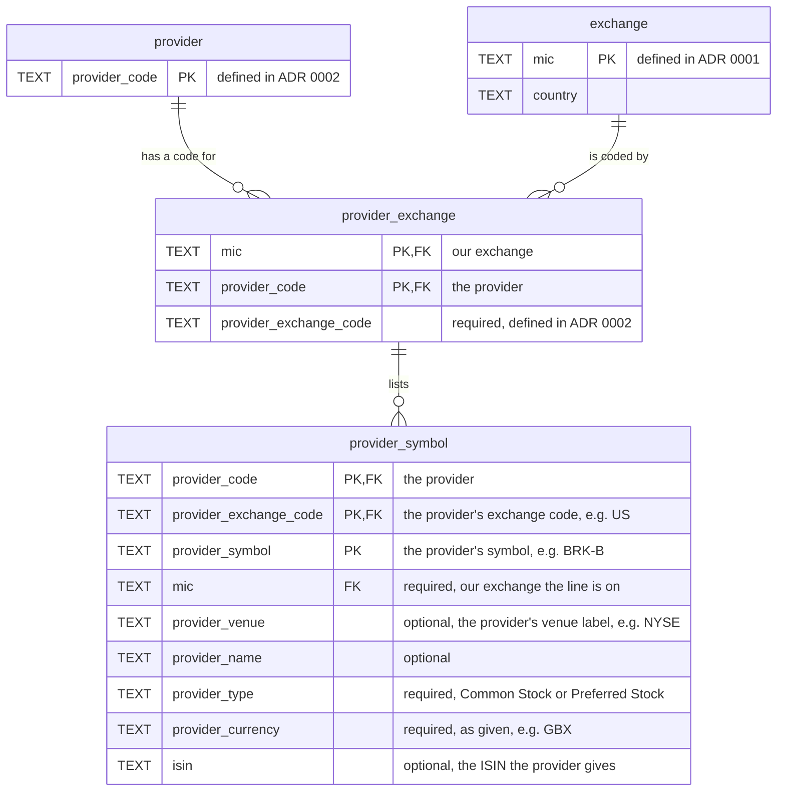

# ADR 0018: Exchanges come from committed files, and a provider's symbol list is stored

- Status: Accepted. The venue labels on the provider's US lines, and whether every line carries one, are to be confirmed at the first live download. ADR 0024 changes three points: a venue label can be left out by a row without a market, a label the file does not know stops the load of a list and not its download, and a list in which a symbol appears twice is not stored. ADR 0025 removes the columns `provider_venue` and `provider_type` from `provider_symbol`; the load still reads both values from a list. ADR 0026 drops the index `provider_symbol_isin`: the listing rule reads the lines once and looks them up in memory. ADR 0028 settles what this record left open on fundamentals payloads: they are kept in files, one per provider line.
- Date: 2026-11-26
- Changes: ADR 0002. Its three tables and its view stand. `provider_exchange` gets one more unique key, and the consequence "a provider's exchange catalogue is not modelled" no longer holds for the provider's symbols.

## Decision

Two things are settled here: where the rows of `exchange` and `provider_exchange` come from, and where a provider's list of symbols is kept.

| Point | Decision |
|---|---|
| Our exchanges | A committed file, `src/pyvalue/listings/reference/exchange.csv` (`mic`, name, country), fills `exchange` |
| Germany | Only Xetra gets a row. The regional exchanges (Frankfurt's floor, Stuttgart, Munich, Düsseldorf, Hamburg, Hanover) get none, so their lines are not stored. Decided by the author on 2026-11-26 |
| The provider's codes | A committed file per provider, `src/pyvalue/providers/eodhd_exchange.csv` (provider exchange code, venue label, `mic`), fills `provider_exchange` |
| A provider code that covers several exchanges | The venue label on each symbol line picks the exchange. EODHD's `US` is such a code |
| The provider's symbol list | Stored in a new table, `provider_symbol`: one row per line that is a common or preferred share on one of our exchanges |
| The provider's live exchange list | Not stored. It is compared with the file: a code the provider offers that the file lacks is reported, and so is a code in the file that the provider no longer offers |
| The downloaded lists | Saved under `data/eodhd/`, never committed. The table is filled from the saved files, so a rebuilt database needs no new request |

## Diagram



`PK` is a primary key, `FK` a foreign key. `provider`, `exchange` and `provider_exchange` are the tables of ADR 0001 and ADR 0002.

## The two committed files

### `exchange.csv`: our exchanges

| Column | Meaning |
|---|---|
| `mic` | The market's ISO 10383 code |
| `name` | The market's name |
| `country` | The market's ISO 3166 country code |

It follows the rule of ADR 0001 for which code a market gets. It lists the markets a provider serves; a market no provider serves needs no row.

### `eodhd_exchange.csv`: the provider's codes

| Column | Meaning |
|---|---|
| `provider_exchange_code` | The code EODHD uses, in its requests and in its lists |
| `provider_venue` | The venue label EODHD writes on a symbol line. Left blank when every line of the code is on one exchange |
| `mic` | Our exchange. Left blank for a code that is left out on purpose |

Example rows:

| `provider_exchange_code` | `provider_venue` | `mic` | Read as |
|---|---|---|---|
| `KO` | | `XKRX` | Every line of EODHD's `KO` list is on Korea Exchange |
| `XETRA` | | `XETR` | Every line of the `XETRA` list is on Xetra |
| `US` | `NYSE` | `XNYS` | A line of the `US` list labelled `NYSE` is on the New York Stock Exchange |
| `US` | `NASDAQ` | `XNAS` | A line of the `US` list labelled `NASDAQ` is on Nasdaq |
| `F` | | | EODHD's Frankfurt list is left out on purpose |

How the file is used:

| Use | Rule |
|---|---|
| Filling `provider_exchange` | One row per distinct pair of `mic` and code |
| Finding the exchange of a symbol line | A code with a blank label gives its one exchange. A code with labels gives the exchange of the line's label |
| A line whose label is not in the file | The download of that list stops. No row of that list is replaced until the label is added to the file |
| A code with a blank label and a labelled row | Refused when the file is read |
| A code with no `mic` | Left out on purpose: its list is not downloaded, it fills no row of `provider_exchange`, and the comparison with the live exchange list does not report it. Used for Germany's regional exchanges and for the provider's lists that are not stock exchanges |

## Tables

How to read the table below:

- **Key**: `PK` is the primary key; where several columns are marked `PK`, together they are the key. `FK` is a foreign key.
- **Required**: "yes" means the column can never be empty. "no" means an empty value is a valid state.

### `provider_symbol`

One row per line of a provider's symbol list that is a common or preferred share on one of our exchanges.

| Column | Type | Key | Required | Constraint | Meaning |
|---|---|---|---|---|---|
| `provider_code` | TEXT | PK, FK | yes | With `mic` and `provider_exchange_code`, must be a row of `provider_exchange` | The provider |
| `provider_exchange_code` | TEXT | PK, FK | yes | As above | The provider's exchange code whose list the line is in |
| `provider_symbol` | TEXT | PK | yes | Not empty, no leading or trailing spaces | The symbol the provider uses, exactly as given |
| `mic` | TEXT | FK | yes | As above | Our exchange the line is on |
| `provider_venue` | TEXT | | no | Not empty when present | The provider's venue label for the line, as given. Empty when the provider gives none |
| `provider_name` | TEXT | | no | Not empty when present | The provider's name for the security. Empty when the provider gives none |
| `provider_type` | TEXT | | yes | `Common Stock` or `Preferred Stock` | The provider's type for the line |
| `provider_currency` | TEXT | | yes | Not empty, no leading or trailing spaces | The currency code as the provider gives it. It can be a sub-unit, such as `GBX` for pence |
| `isin` | TEXT | | no | 12 characters: two letters, nine letters or digits, one digit | The ISIN the provider gives for the line. Empty when it gives none or a malformed one |

Example rows:

| `provider_code` | `provider_exchange_code` | `provider_symbol` | `mic` | `provider_venue` | `provider_name` | `provider_type` | `provider_currency` | `isin` | Read as |
|---|---|---|---|---|---|---|---|---|---|
| `eodhd` | `KO` | `000660` | `XKRX` | `KO` | SK Hynix Inc | `Common Stock` | `KRW` | `KR7000660001` | EODHD lists SK Hynix as `000660.KO` |
| `eodhd` | `US` | `BRK-B` | `XNYS` | `NYSE` | Berkshire Hathaway Inc | `Common Stock` | `USD` | `US0846707026` | EODHD lists Berkshire's B share as `BRK-B.US`, on the New York Stock Exchange |
| `eodhd` | `LSE` | `SHEL` | `XLON` | `LSE` | Shell plc | `Common Stock` | `GBX` | `GB00BP6MXD84` | A London line quoted in pence |
| `eodhd` | `KLSE` | `1155` | `XKLS` | `KLSE` | Malayan Banking Bhd | `Common Stock` | `MYR` | | A line for which EODHD gives no ISIN |

The venue labels shown are what EODHD's documentation leads one to expect; they have not been seen live.

Notes:

- **The key is the provider, its exchange code and its symbol.** That is how EODHD itself identifies a line: `BRK-B.US`. Two rows cannot share it, so the same symbol cannot be stored once on New York and once on Nasdaq.
- **`mic` says which of our exchanges the line is on.** It is worked out from the code and the venue label when the list is stored.
- **`provider_currency` is the provider's code, not ours.** The listing rule turns a sub-unit into its currency (ADR 0019).
- **`isin` is the provider's claim.** It is missing on a quarter to a third of the lines and can be out of date.
- **Only shares are stored.** A fund, a warrant or a bond in the provider's list gets no row.

### One more unique key on `provider_exchange`

| Key | Why |
|---|---|
| `provider_exchange (mic, provider_code, provider_exchange_code)`, unique | A foreign key needs a unique key to point at. The table's primary key, `mic` plus `provider_code`, does not include the code, and the code alone is not unique: `US` covers several exchanges |

It adds no new rule to `provider_exchange`: its primary key already makes these three columns unique together.

## Rules

| Rule | What it means |
|---|---|
| One list is replaced as a whole | When the list of one provider exchange code is stored again, the rows of that code are deleted and written again, in one transaction |
| A list that is suspiciously short is refused | When a new list has at least 20 fewer rows than the stored one and fewer than half as many, nothing is replaced and the code is reported. EODHD once answered for a dropped exchange with a stub of 30 lines |
| A line on no exchange of ours is not stored | A line can only sit on an exchange its code is mapped to |
| Nothing is deleted implicitly | A `provider_exchange` row that still has symbols cannot be deleted |
| A changed `mic` or `provider_code` follows through | If either is corrected, the symbol rows are updated with it |
| One repository class per table | `ProviderSymbolRepository`, and repositories for `exchange`, `provider` and `provider_exchange` when the code first needs them (ADR 0008) |

## What the schema does not enforce

| Not enforced | Consequence |
|---|---|
| That `mic` is the exchange the venue label stands for | The schema checks only that the exchange is one the code is mapped to. The step that stores the list applies the file |
| That a `provider_listing` row names a line in `provider_symbol` | `provider_listing` has no exchange column to join on; its exchange is the listing's. ADR 0019 checks it when a listing is written |
| That `provider_currency` is a code the listing rule knows | An unknown code is reported by the listing rule, and the line is not used |
| That two exchange codes do not list the same share | EODHD's KOSDAQ list has carried KOSPI lines. The listing rule sees two lines and sends the security to the agent |

## Indexes

| Index | Created by | Query it serves |
|---|---|---|
| `provider_symbol (provider_code, provider_exchange_code, provider_symbol)` | The primary key | Find one line; read or replace the list of one provider exchange code |
| `provider_symbol (mic, provider_code, provider_exchange_code)` | `CREATE INDEX provider_symbol_exchange` | The lines on one of our exchanges, which is how the listing rule collects the lines of a country; the foreign-key check when a `provider_exchange` row is deleted or corrected |
| `provider_symbol (isin)`, rows with an ISIN only | `CREATE INDEX provider_symbol_isin` | The lines that carry a given ISIN, the first lookup of the listing rule |
| `provider_exchange (mic, provider_code, provider_exchange_code)` | `CREATE UNIQUE INDEX provider_exchange_code_key` | It is the key the foreign key of `provider_symbol` points at. Its leading columns repeat the primary key; it exists only for that purpose |

## Normalisation

`provider_symbol` is in Boyce-Codd normal form with one deliberate deviation.

| Point | Reasoning |
|---|---|
| Every other column depends on the whole key | The name, type, currency, ISIN and venue label are what the provider says about that one line |
| The deviation: `mic` | It follows from the code and the venue label through the committed file, so it could be worked out again. It is stored because the foreign key needs it, and because the listing rule reads the lines of a country through it for every security |
| Kept consistent by | The foreign key (the exchange must be one the code is mapped to) and by replacing a list as a whole |

## Why this design

- **The author wants the lists in the database,** so that a listing can be looked up, reported and reviewed with queries.
- **Our exchanges are our reference data.** Their names and countries come from the ISO standard, not from a provider. EODHD's own name for `US` is "USA Stocks", which is not the name of any exchange.
- **The mapping is a small file a person can review.** It is about 70 rows, and it changes only when a provider adds or drops a market.
- **The venue label decides for `US`.** ADR 0002 already gives New York and Nasdaq separate rows under one EODHD code. The symbol line is the only place that says which of them a share is on.
- **The lists are kept as files too,** because they can only be downloaded while a subscription is active.

## Evidence

- **EODHD's exchange list,** as stored by the legacy project in October 2026: 70 codes, each with a name, a country, a currency and the market codes it covers. 64 stock-exchange codes cover one market. `US` covers `XNAS`, `XNYS`, `OTCM` and `XCBO`. Five codes are not stock exchanges (funds, bonds, money market, currencies, crypto).
- **The fields of a symbol line,** from EODHD's documentation and the legacy client: `Code`, `Name`, `Country`, `Exchange`, `Currency`, `Type`, `Isin`. The legacy project never read `Exchange`, so the labels of `US` lines have not been recorded anywhere.
- **Germany:** of the 147 German securities the two funds hold, 146 have a Xetra line and 138 of those also have lines on regional exchanges, all carrying the same ISIN. One, Covestro, has only Frankfurt and Stuttgart lines. The six regional lists hold 20,578 of the 71,322 lines in the legacy catalogue, most of them copies of foreign shares.
- **Missing ISINs:** 53,312 of the 71,322 lines in the legacy catalogue carry one. EODHD gave one for 66% of its US lines and 74% of its Warsaw lines.
- **Currencies on one exchange:** the legacy London list has 2,467 lines in pence, 2,253 in US dollars, 1,135 in euros and 912 in pounds. The sub-unit codes seen are `GBX`, `ZAC` (South African cents) and `ILA` (Israeli agorot).
- **A stub answer:** on 2026-07-11 EODHD answered for an exchange it had dropped with HTTP 200 and 30 lines. The legacy refresh removed 2,835 listings before a guard was added.
- **Cost:** one request for the exchange list and one per exchange code, about 70 in all.
- **The statements were run in a scratch SQLite database** on 2026-11-26, together with those of ADR 0017, on top of migration `0001`. Rejected, among the 37 invalid statements: a line on an exchange its code is not mapped to, a second row for one symbol under one code, a line of type `ETF`, a malformed ISIN, and the delete of a mapping that still has symbols. A corrected `mic` on `exchange` followed through to the symbol rows.
- **The indexes are used:** the query plans for "lines that carry an ISIN", "lines on one of our exchanges" and "lines under one provider code" each search an index.

## Consequences

- **A provider line can be looked up without a request to the provider.**
- **Coverage is a query:** the countries with an exchange in `provider_exchange` are the markets the provider serves.
- **The table is as old as the last download.** A share listed since then is not in it.
- **A German share that is not on Xetra gets no listing.** Today that is one security.
- **About 50,000 rows** for EODHD, going by the legacy catalogue without the German regional lists. They are a lookup list only: no company, listing or payload hangs off a row, and what is in the universe still comes from the funds (ADR 0016).
- **A new venue label stops a download** until a person adds it to the file. That is deliberate: a line stored on the wrong exchange would be worse.
- **The first live download completes the file** for `US`. Until then the labels in this record are an expectation.
- **A second provider** needs its own exchange file and rows; the table does not change.
- **A migration adds the table and the unique key.**

## Alternatives considered

| Alternative | Why not |
|---|---|
| Keep the lists only as files and match in memory | The author wants them in the database; and a report or an agent can then query them |
| Key the table by `mic` and symbol | The same symbol could be stored on two exchanges of one provider code, which the provider's own identity for a line rules out |
| No foreign key from the symbol to the mapping | The project's rule is that referential integrity is enforced by the schema |
| A table for the provider's own exchange list | Its extra facts, a name and a currency per code, have no use. The committed file is the reference |
| Fill `exchange` from the provider's exchange list | Our exchange names and countries would be a provider's, against ADR 0002 |
| A table mapping venue labels to exchanges | A dozen rows that change with the provider's wording. A committed file is enough |
| Store every type of security | Funds and warrants are never candidates for a listing |
| Store the line's ISO currency beside the provider's code | It would repeat what the sub-unit map says |

## Not decided here

- The rows of the two files. They are written with the code, from the legacy exchange list and the ISO 10383 table.
- Prices, fundamentals and raw provider payloads.
- How a listing is determined from these lines (ADR 0019).

## Appendix: SQL

The exact statements, for SQLite. They say the same as the tables above. `provider_exchange` is as in ADR 0002.

```sql
-- The key the foreign key of provider_symbol points at. The primary key of
-- provider_exchange (mic, provider_code) already makes these three columns
-- unique together. SQLite needs a unique key on exactly the referenced columns.
CREATE UNIQUE INDEX provider_exchange_code_key
    ON provider_exchange (mic, provider_code, provider_exchange_code);

CREATE TABLE provider_symbol (
    provider_code          TEXT NOT NULL,
    provider_exchange_code TEXT NOT NULL,
    provider_symbol        TEXT NOT NULL CHECK (provider_symbol <> '' AND provider_symbol = trim(provider_symbol)),
    mic                    TEXT NOT NULL,
    provider_venue         TEXT CHECK (provider_venue <> '' AND provider_venue = trim(provider_venue)),
    provider_name          TEXT CHECK (provider_name <> '' AND provider_name = trim(provider_name)),
    provider_type          TEXT NOT NULL CHECK (provider_type IN ('Common Stock', 'Preferred Stock')),
    provider_currency      TEXT NOT NULL
                           CHECK (provider_currency <> '' AND provider_currency = trim(provider_currency)),
    isin                   TEXT
                           CHECK (length(isin) = 12 AND isin NOT GLOB '*[^A-Z0-9]*' AND isin GLOB '[A-Z][A-Z]*[0-9]'),
    PRIMARY KEY (provider_code, provider_exchange_code, provider_symbol),
    FOREIGN KEY (mic, provider_code, provider_exchange_code)
        REFERENCES provider_exchange (mic, provider_code, provider_exchange_code)
        ON UPDATE CASCADE ON DELETE RESTRICT
);

-- Serves "the lines on one of our exchanges" and the foreign-key check when a
-- provider_exchange row is deleted or corrected.
CREATE INDEX provider_symbol_exchange ON provider_symbol (mic, provider_code, provider_exchange_code);

-- Serves "the lines that carry this ISIN". Lines without an ISIN are left out.
CREATE INDEX provider_symbol_isin ON provider_symbol (isin) WHERE isin IS NOT NULL;
```
