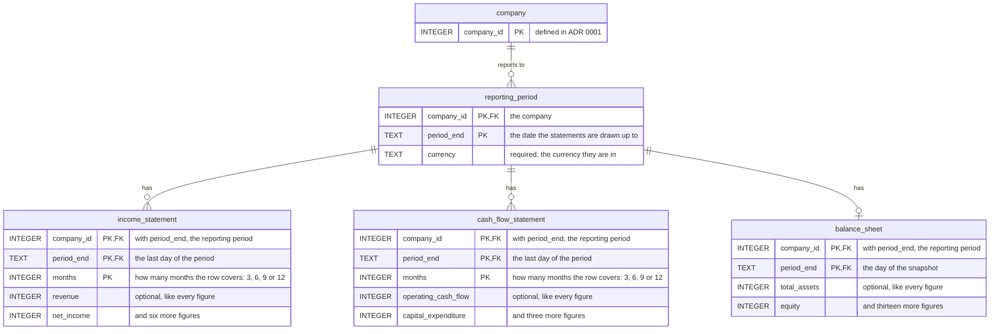

# ADR 0029: A company's financial statements are stored by reporting period

- Status: Accepted
- Date: 2026-11-27
- Settles: the first point ADR 0028 left open, how payloads are read into tables. What is checked while they are read is ADR 0030.

## Decision

The fiscal-year rows of the saved fundamentals payloads (ADR 0028) are read into four tables. Only the figures the QARP screen reads get a column: 28 of them.

| Table | One row is |
|---|---|
| `reporting_period` | A date to which a company's statements are drawn up, with the currency they are in |
| `income_statement` | The company's income statement for a period ending on that date |
| `cash_flow_statement` | Its cash-flow statement for a period ending on that date |
| `balance_sheet` | Its balance sheet on that date |

The statements belong to the company, not to a listing or a provider. No table of this record names a provider.

This record covers the fiscal years. Interim rows (quarters and half-years) are the next step. The key of the two flow tables is built for them: it holds the number of months a row covers.

## Diagram



`PK` is a primary key, `FK` a foreign key. `company` is the table of ADR 0001, shown with its key only.

## Tables

How to read the tables below:

- **Key**: `PK` is the primary key; where several columns are marked `PK`, together they are the key. `FK` is a foreign key.
- **Required**: "yes" means the column can never be empty. "no" means an empty value is a valid state: the provider did not report the figure, or the load emptied it (ADR 0030).
- **From**: the field of EODHD's payload the value is read from. Another provider would fill the same columns from its own fields.
- **Amounts** are whole numbers in the main unit of the period's currency: dollars, not cents, and pounds, not pence.

### `reporting_period`

One row per company and date that has at least one statement stored.

| Column | Type | Key | Required | Constraint | Meaning |
|---|---|---|---|---|---|
| `company_id` | INTEGER | PK, FK → `company.company_id` | yes | The company must exist | The company |
| `period_end` | TEXT | PK | yes | A date written as `YYYY-MM-DD` | The date the statements are drawn up to |
| `currency` | TEXT | | yes | Three upper-case letters | The ISO 4217 code of the currency the statements of that date are in. Never a sub-unit such as `GBX` |

Example rows (the company ids are made up):

| `company_id` | `period_end` | `currency` | Read as |
|---|---|---|---|
| 4120 (Microsoft) | `2026-06-30` | `USD` | Microsoft's fiscal year to June 2026 is reported in US dollars |
| 4120 (Microsoft) | `2025-06-30` | `USD` | The year before |
| 5210 (SK Hynix) | `2025-12-31` | `KRW` | SK Hynix reports in won |

### `income_statement`

One row per company, period end and length.

| Column | Type | Key | Required | From | Constraint | Meaning |
|---|---|---|---|---|---|---|
| `company_id` | INTEGER | PK, FK | yes | | With `period_end`, must be a row of `reporting_period` | The company |
| `period_end` | TEXT | PK, FK | yes | `date` | As above | The last day of the period |
| `months` | INTEGER | PK | yes | | 3, 6, 9 or 12 | How many months the row covers, back from `period_end`. 12 is a fiscal year |
| `revenue` | INTEGER | | no | `totalRevenue` | | Revenue |
| `cost_of_revenue` | INTEGER | | no | `costOfRevenue` | Not negative | Cost of the goods and services sold |
| `gross_profit` | INTEGER | | no | `grossProfit` | | Gross profit, as reported |
| `operating_income` | INTEGER | | no | `operatingIncome` | | Operating profit, as reported |
| `pretax_income` | INTEGER | | no | `incomeBeforeTax` | | Profit before income tax |
| `income_tax` | INTEGER | | no | `incomeTaxExpense`, and `taxProvision` where the first is missing | | Income tax charged to the period. Negative for a tax credit |
| `net_income` | INTEGER | | no | `netIncome` | | Net profit |
| `interest_expense` | INTEGER | | no | `interestExpense` | Not negative | Interest charged to the period |

A row must hold at least one figure.

Example row: Microsoft, `2026-06-30`, 12 months, in millions here for width (the table holds whole dollars).

| `revenue` | `cost_of_revenue` | `gross_profit` | `operating_income` | `pretax_income` | `income_tax` | `net_income` | `interest_expense` |
|---|---|---|---|---|---|---|---|
| 331,839 | 106,374 | 225,465 | 155,237 | 165,934 | 32,185 | 133,749 | 3,051 |

### `cash_flow_statement`

One row per company, period end and length.

| Column | Type | Key | Required | From | Constraint | Meaning |
|---|---|---|---|---|---|---|
| `company_id` | INTEGER | PK, FK | yes | | With `period_end`, must be a row of `reporting_period` | The company |
| `period_end` | TEXT | PK, FK | yes | `date` | As above | The last day of the period |
| `months` | INTEGER | PK | yes | | 3, 6, 9 or 12 | How many months the row covers |
| `operating_cash_flow` | INTEGER | | no | `totalCashFromOperatingActivities` | | Cash from operations |
| `capital_expenditure` | INTEGER | | no | `capitalExpenditures` | Not negative | Cash paid for property, plant and equipment. A positive number is cash going out |
| `depreciation_amortization` | INTEGER | | no | `depreciation` | Not negative | Depreciation and amortisation added back |
| `dividends_paid` | INTEGER | | no | `dividendsPaid` | Not negative | Cash dividends paid. A positive number is cash going out |
| `net_share_sales` | INTEGER | | no | `salePurchaseOfStock` | | Shares sold minus shares bought back. Negative when the company bought back more than it sold |

A row must hold at least one figure.

Example row: Microsoft, `2026-06-30`, 12 months, in millions.

| `operating_cash_flow` | `capital_expenditure` | `depreciation_amortization` | `dividends_paid` | `net_share_sales` |
|---|---|---|---|---|
| 182,935 | 115,948 | 38,534 | 26,445 | -22,271 |

### `balance_sheet`

One row per company and date. A balance sheet is a snapshot, so it has no length.

| Column | Type | Key | Required | From | Constraint | Meaning |
|---|---|---|---|---|---|---|
| `company_id` | INTEGER | PK, FK | yes | | With `period_end`, must be a row of `reporting_period` | The company |
| `period_end` | TEXT | PK, FK | yes | `date` | As above | The day of the snapshot |
| `total_assets` | INTEGER | | no | `totalAssets` | Above zero | Total assets |
| `total_liabilities` | INTEGER | | no | `totalLiab` | Not negative | Total liabilities |
| `equity` | INTEGER | | no | `totalStockholderEquity` | | Equity of the company's own shareholders. Can be negative |
| `minority_interest` | INTEGER | | no | `noncontrollingInterestInConsolidatedEntity` | | Equity that belongs to outside shareholders of subsidiaries |
| `cash` | INTEGER | | no | `cash` | Not negative | Cash |
| `short_term_investments` | INTEGER | | no | `shortTermInvestments` | Not negative | Short-term investments |
| `cash_and_short_term_investments` | INTEGER | | no | `cashAndShortTermInvestments` | Not negative | The provider's own total of the two |
| `short_term_debt` | INTEGER | | no | `shortTermDebt` | Not negative | Borrowings due within a year |
| `long_term_debt` | INTEGER | | no | `longTermDebt` | Not negative | Borrowings due later |
| `total_debt_stated` | INTEGER | | no | `shortLongTermDebtTotal` | Not negative | The provider's own total of debt. It is not the sum of the two columns before it |
| `lease_obligations` | INTEGER | | no | `capitalLeaseObligations` | Not negative | Lease liabilities |
| `current_assets` | INTEGER | | no | `totalCurrentAssets` | Not negative | Current assets |
| `current_liabilities` | INTEGER | | no | `totalCurrentLiabilities` | Not negative | Current liabilities |
| `noncurrent_liabilities` | INTEGER | | no | `nonCurrentLiabilitiesTotal` | Not negative | Liabilities due after a year |
| `shares_outstanding` | INTEGER | | no | `commonStockSharesOutstanding` | Above zero | The number of shares outstanding. A count, not an amount of money |

A row must hold at least one figure.

Example row: Microsoft, `2026-06-30`, in millions (the share count in millions of shares). Minority interest is empty.

| `total_assets` | `total_liabilities` | `equity` | `cash` | `short_term_investments` | `cash_and_short_term_investments` | `short_term_debt` | `long_term_debt` | `total_debt_stated` | `lease_obligations` | `current_assets` | `current_liabilities` | `noncurrent_liabilities` | `shares_outstanding` |
|---|---|---|---|---|---|---|---|---|---|---|---|---|---|
| 758,376 | 315,989 | 442,387 | 20,935 | 55,908 | 76,843 | 18,905 | 31,067 | 128,808 | 16,532 | 207,710 | 168,825 | 147,164 | 7,453 |

## Rules

### What is stored

| Rule | What it means |
|---|---|
| Only reported figures | A column holds what the provider reports under that name, or nothing. Nothing is derived, filled from another figure or carried from another period |
| An empty cell means "not known" | It is never a zero. A zero is stored only when the provider reports zero and no check empties it (ADR 0030) |
| Two readings of debt are kept | The provider states debt as two parts and as a total. They agree on about a third of the rows that have both, so both are stored and a metric chooses |
| One reading of income tax is kept | `incomeTaxExpense` and `taxProvision` are two fields for one fact. The first is read, and the second only where the first is missing |
| Amounts are whole numbers | A payload amount is rounded to the nearest whole unit, a half to the even one. The tables are `STRICT`, so a floating-point number cannot be stored |
| No conversion | An amount stays in the currency it was reported in. No FX rate is applied anywhere in the load |
| A sub-unit label is read as its currency | `GBX`, `ZAC` and `ILA` on a statement row are read as `GBP`, `ZAR` and `ILS` with the amount unchanged, and the load reports it (ADR 0030) |
| No filing date | The payload's `filing_date` is not stored |

### Which rows are a company's fiscal years

The payload has no field that says how long a period is. The load works it out from the dates, once per company, for all three statements together.

| Step | Rule |
|---|---|
| 1. The dates | Every date on which the payload has a yearly row in any of the three statements |
| 2. The latest year | The latest date is the end of the latest fiscal year |
| 3. The year before | The date 350 to 380 days earlier ends the year before. Of two such dates the one nearest to 365 days is taken, and of two equally near the later |
| 4. A proven year | A year is **proven** when step 3 finds the year before it. Its income and cash-flow rows are then known to cover 12 months |
| 5. A break | When step 3 finds no date, the year is **not proven**, and the walk goes on from the nearest earlier date |
| 6. The window | The first 12 years of the walk are the company's fiscal years. Any other yearly date after the oldest of them is off the chain and is not stored |

What is stored for a fiscal year:

| Statement | A proven year | A year that is not proven |
|---|---|---|
| Balance sheet | Stored | Stored: a snapshot has no length |
| Income statement | Stored with `months` 12 | Not stored, and reported |
| Cash-flow statement | Stored with `months` 12 | Not stored, and reported |

A year is not proven in three cases: it is the oldest year the payload holds, the year before it is missing, or the company moved its year end.

### The currency of a period

A period has one currency, for all its statements.

| Case | The period's currency |
|---|---|
| The period's rows carry one currency label between them | That currency |
| They carry two | None: the period is not stored, and reported |
| They carry none, and the company's other fiscal years all have the same currency | That currency |
| They carry none, the other years settle nothing, and the three statements name one currency in their own header | That currency |
| Otherwise | None: the period is not stored, and reported |

### A company with several listed securities

Each listed security has its own payload, and each payload holds the company's statements. One payload is read.

| Order | The payload that is read |
|---|---|
| 1 | That of a common share before that of a preferred share |
| 2 | The one with more fiscal years |
| 3 | The one of the security with the smaller ISIN |

The other payloads are compared with it, and a disagreement is reported (ADR 0030).

### The load

| Rule | What it means |
|---|---|
| One command | `pyvalue fundamentals load` reads the saved payloads and fills the four tables. It never contacts the provider |
| The tables are replaced as a whole | Every run deletes the rows of the four tables and writes them again, in one transaction. There is no record of what changed |
| The same payloads give the same rows | The load reads no clock and no order of files for a row. It is run again after any change to a rule |
| An incomplete payload folder stops the load | When fewer than half of the listings have a saved payload, the load stops and changes nothing |
| A rebuild has a fifth step | A rebuilt database starts with these tables empty and with new company ids, so `pyvalue fundamentals load` is run after `pyvalue listings fill` |
| One repository class per table | Under the rules of ADR 0008. Each gets the methods the load calls: add a row, and remove all rows |

## What the schema does not enforce

| Not enforced | Consequence |
|---|---|
| That a row with `months` 12 is a fiscal year | The chain rule above guarantees it. The schema only allows the four lengths |
| That a company's fiscal years are 12 months apart | The chain rule guarantees it for the years it calls proven |
| That a reporting period has a statement | The load writes a period only with at least one statement. The schema would accept a period without one |
| That an amount is below 10^17 | The load empties a larger value (ADR 0030). The schema's own limit is that of a 64-bit integer |
| That `currency` is a currency that exists | The schema checks the shape. The load takes the provider's code |

## Indexes

| Index | Created by | Query it serves |
|---|---|---|
| `reporting_period (company_id, period_end)` | The primary key | The periods of one company; the foreign-key check when a company is deleted |
| `income_statement (company_id, period_end, months)` | The primary key | The income statements of one company, by date; the foreign-key check when a period is deleted |
| `cash_flow_statement (company_id, period_end, months)` | The primary key | The same for the cash-flow statements |
| `balance_sheet (company_id, period_end)` | The primary key | The balance sheets of one company, by date; the foreign-key check when a period is deleted |

No other index: nothing looks a statement up except by company.

## Normalisation

All four tables are in Boyce-Codd normal form.

| Point | Reasoning |
|---|---|
| A figure depends on the whole key | Revenue is a fact about one company, one period end and one length. So is every other column of the three statement tables |
| The currency is stored once | It is a fact about the company and the date, not about one statement. With a currency column on each statement table the same fact would be stored three times and could disagree, which it does in the payloads for 89 fiscal years. `reporting_period` holds it once, and a statement cannot exist without its period |
| A total beside its parts | `cash_and_short_term_investments` and `total_debt_stated` are not derived from the columns beside them. Each is a figure the provider reports on its own, and a difference between a total and its parts is information |
| One column per figure | The set of figures is fixed by what the metrics read. A table of name and value pairs would repeat the period and its length on every row and could not check a single figure |

One deliberate deviation from the project's default for money: amounts are whole main units, not minor units such as cents. A company's statements are reported in thousands or millions, the provider's fractions are artefacts of its own arithmetic, and a number 100 times larger than the reported one is the kind of unit error this project has met before.

## Why this design

- **The statements describe a business.** 98 companies have two or three listed securities. Keyed by listing, each would have two sets of the same statements, and for 15 of them the sets disagree.
- **The yearly rows are the reliable part of the payload.** Core figures are present on 99% of them. The interim rows are not reliable quarters, so they are added only once each can be proven against its fiscal year.
- **A period's length is stored, not a label.** The payload does not give the fiscal quarter. Fiscal years end in any month, half-year reporters have no quarters, and a label such as "Q3" would have to be guessed.
- **A wrong length is worse than a missing row.** A first annual report often covers a short period. Stored as 12 months it would understate the first year and inflate every growth rate that starts there.
- **The load is fast enough to be simple.** Reading every payload takes about a minute, so the tables are replaced as a whole and nothing tracks changes.

## Evidence

Measured on 2026-11-27 on the 8,309 saved payloads. No request was made.

| Fact | Measurement |
|---|---|
| The statements were run in a scratch SQLite database | 8 valid statements were accepted and 37 invalid ones were each refused by the intended constraint: a statement without its period, a second currency for a period, a date that does not exist, a length of 4 months, an amount with a fraction, a row with no figure, each forbidden negative, and deletes of a period or a company that rows still point at |
| An amount given as `5.0` | Stored as the integer 5. An amount of `1.5` is refused |
| The query plans | "The income statements of one company" and the foreign-key checks search the primary keys |
| Companies | The 8,309 listings are 8,210 companies. 97 have two listed securities and one has three |
| Core figures on yearly rows since 2015 | Present on 99% or more. Income tax 93%, a debt figure 95% |
| Companies with ten or more fiscal years in a row | 6,926 before the oldest year's income row is left out |
| Payloads with a yearly row in the window that is off the chain | 96 |
| Of those, payloads with yearly rows about six months apart | 36. A company moved its year end, and the provider kept rows for both year ends |
| Payloads with two yearly rows within 30 days of each other | 29 |
| Rows without a currency label | 8% of all rows. All but 245 yearly rows in the window take the one currency the company's other years share |
| Fiscal years since mid-2014 whose statements carry different currencies | 89, in 47 payloads |
| Rows labelled `GBX` or `ZAC` | In 22 payloads. In all 33 rows that could be compared with a neighbour in pounds or rand, the amount is at the same scale |
| The two income-tax fields | Both present on 70,791 yearly rows since 2015. Where they differ (7,835 rows), `incomeTaxExpense` is nearer to pre-tax income minus net income on 70% |
| Debt as parts and as a total | The total is present on 86% of yearly rows, a part on 93%. They agree on 35% of the rows that have the total |
| `operatingIncome` and `ebit` | Equal on 25% of the rows that have both. `operatingIncome` is the reported operating profit; `ebit` is another measure and is not read |
| Fractions | No payload amount has more than two decimals. 3.8% have a fraction; among the yearly revenue figures since 2015 that have one, all but ten are above a million |
| `filing_date` | Equal to the period end on 55% of yearly rows since 2015, and missing on 10% |
| The oldest yearly row | Where the window reaches a payload's oldest row, its revenue is under 60% of the next year's in 22% of 1,720 cases, against 6% for other pairs of years |
| Time | Unpacking and parsing all payloads is about 45 seconds of work on one process |

## Consequences

- **Every company's oldest year has no income or cash-flow row.** A company with exactly ten years of history has nine years of flows and waits one more year for the ten-year gates.
- **A metric reads a period's currency from `reporting_period`.** A company whose reporting currency changed has years in two currencies, and nothing converts them.
- **A figure is added by a migration.** A new column starts empty and is filled by the next load.
- **The tables hold one provider's view.** With a second provider, where a period's statements came from would have to be recorded.
- **Company ids change at a rebuild,** and the load derives them afresh. The report of the load therefore never uses a company id.
- **`docs/database/` gets four files,** and the rebuild steps in `CLAUDE.md` and in every message that gives them get a fifth step.

## Alternatives considered

| Alternative | Why not |
|---|---|
| One long table of company, figure name, period and value | It repeats the currency and the period on every row, cannot check a single figure, and holds ten times the rows. The legacy project's table had that shape |
| Statements keyed by listing | 98 companies would have their statements twice |
| A currency column on each statement table | The same fact stored three times, with nothing to stop two currencies for one year |
| Floating-point amounts | Excluded by the project's rules for money |
| Amounts in minor units | A stored number 100 times the reported one, for no figure that needs cents |
| Amounts as decimal text | Exact, but the database could not compare or check them |
| A label per row, such as `FY` or `Q3` | The payload gives no fiscal quarter, and half-year reporters have none |
| A start date beside the end date | The end date and the months give it |
| Storing every year the payload has | QARP reads 11 years. Older rows would be checked and reported for no reader |
| Trusting the oldest row as a 12-month year | Measured: a short first period is common enough to matter |
| Choosing the fiscal years per statement | The three statements have different yearly dates in many payloads, and would then keep different years |
| Several processes for the load | It would save about 30 seconds on a command that is run now and then, and add a second code path. It can be added when interim rows make the load longer |
| Loading only what changed | A full load is fast, and a rule change has to reach every row |
| PostgreSQL | One user, one writer and a batch load: a server would add nothing |

## Not decided here

- **Interim rows:** how a quarter, a half-year or a year-to-date row is proven against its fiscal year, and what happens in the running year.
- **The checks of the load and its report** (ADR 0030), and how a correction comes back.
- **The provider's separate series of share counts.** The balance sheet's own count is stored.
- **Which reading of debt, or of cash, a metric takes.**
- **Prices and FX.**

## Appendix: SQL

The exact statements, for SQLite. They say the same as the tables above. `company` is as in ADR 0001.

```sql
CREATE TABLE reporting_period (
    company_id INTEGER NOT NULL REFERENCES company (company_id) ON DELETE RESTRICT,
    -- IS, not =: date() of a malformed text is NULL, and a comparison with
    -- NULL does not fail a CHECK.
    period_end TEXT NOT NULL CHECK (period_end IS date(period_end)),
    currency   TEXT NOT NULL CHECK (currency GLOB '[A-Z][A-Z][A-Z]'),
    PRIMARY KEY (company_id, period_end)
) STRICT;

CREATE TABLE income_statement (
    company_id       INTEGER NOT NULL,
    period_end       TEXT NOT NULL,
    months           INTEGER NOT NULL CHECK (months IN (3, 6, 9, 12)),
    revenue          INTEGER,
    cost_of_revenue  INTEGER CHECK (cost_of_revenue >= 0),
    gross_profit     INTEGER,
    operating_income INTEGER,
    pretax_income    INTEGER,
    income_tax       INTEGER,
    net_income       INTEGER,
    interest_expense INTEGER CHECK (interest_expense >= 0),
    PRIMARY KEY (company_id, period_end, months),
    FOREIGN KEY (company_id, period_end)
        REFERENCES reporting_period (company_id, period_end) ON DELETE RESTRICT,
    CHECK (coalesce(revenue, cost_of_revenue, gross_profit, operating_income, pretax_income,
                    income_tax, net_income, interest_expense) IS NOT NULL)
) STRICT;

CREATE TABLE cash_flow_statement (
    company_id                INTEGER NOT NULL,
    period_end                TEXT NOT NULL,
    months                    INTEGER NOT NULL CHECK (months IN (3, 6, 9, 12)),
    operating_cash_flow       INTEGER,
    capital_expenditure       INTEGER CHECK (capital_expenditure >= 0),
    depreciation_amortization INTEGER CHECK (depreciation_amortization >= 0),
    dividends_paid            INTEGER CHECK (dividends_paid >= 0),
    net_share_sales           INTEGER,
    PRIMARY KEY (company_id, period_end, months),
    FOREIGN KEY (company_id, period_end)
        REFERENCES reporting_period (company_id, period_end) ON DELETE RESTRICT,
    CHECK (coalesce(operating_cash_flow, capital_expenditure, depreciation_amortization,
                    dividends_paid, net_share_sales) IS NOT NULL)
) STRICT;

CREATE TABLE balance_sheet (
    company_id                      INTEGER NOT NULL,
    period_end                      TEXT NOT NULL,
    total_assets                    INTEGER CHECK (total_assets > 0),
    total_liabilities               INTEGER CHECK (total_liabilities >= 0),
    equity                          INTEGER,
    minority_interest               INTEGER,
    cash                            INTEGER CHECK (cash >= 0),
    short_term_investments          INTEGER CHECK (short_term_investments >= 0),
    cash_and_short_term_investments INTEGER CHECK (cash_and_short_term_investments >= 0),
    short_term_debt                 INTEGER CHECK (short_term_debt >= 0),
    long_term_debt                  INTEGER CHECK (long_term_debt >= 0),
    total_debt_stated               INTEGER CHECK (total_debt_stated >= 0),
    lease_obligations               INTEGER CHECK (lease_obligations >= 0),
    current_assets                  INTEGER CHECK (current_assets >= 0),
    current_liabilities             INTEGER CHECK (current_liabilities >= 0),
    noncurrent_liabilities          INTEGER CHECK (noncurrent_liabilities >= 0),
    shares_outstanding              INTEGER CHECK (shares_outstanding > 0),
    PRIMARY KEY (company_id, period_end),
    FOREIGN KEY (company_id, period_end)
        REFERENCES reporting_period (company_id, period_end) ON DELETE RESTRICT,
    CHECK (coalesce(total_assets, total_liabilities, equity, minority_interest, cash,
                    short_term_investments, cash_and_short_term_investments, short_term_debt,
                    long_term_debt, total_debt_stated, lease_obligations, current_assets,
                    current_liabilities, noncurrent_liabilities, shares_outstanding) IS NOT NULL)
) STRICT;
```
