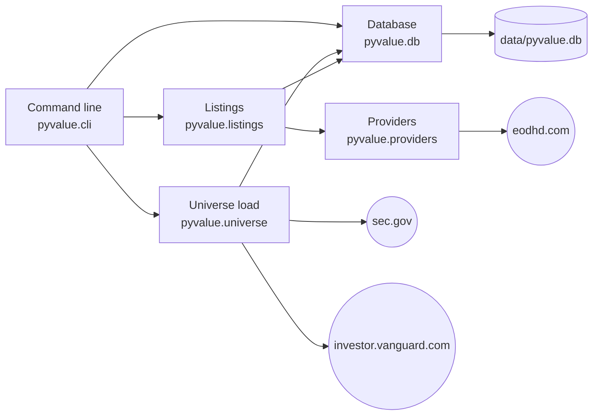

# Architecture

pyvalue is a value-investing toolkit: a curated global stock universe, data-quality checks on fundamental data, and quality-at-a-reasonable-price screening. This document describes how the code is organised. The reasons behind each decision are in the records under [`docs/adr/`](adr/).

Only what has been agreed is described as designed. Everything else is listed as planned or not designed yet.

## Components

| Component | Package | What it does | Status |
|---|---|---|---|
| Database | `pyvalue.db` | Opens the SQLite file, applies migrations, owns every SQL statement | Built: connections, migrations, the unit of work, and the repositories for `company`, `instrument`, `fund`, `holding`, `exchange`, `provider`, `provider_exchange` and `provider_symbol`. A repository is added when a component first needs its table |
| Command line | `pyvalue.cli` | Thin commands that call the components | Built: `pyvalue db migrate`, `pyvalue universe load`, `pyvalue symbols download`, `pyvalue symbols load` |
| Universe load | `pyvalue.universe` | Downloads the SEC holdings filings of VTI and VXUS and Vanguard's own holdings files, reads each fund through its sponsor's adapter, records the funds and the share lines that were loaded in `fund` and `holding`, and fills `company` and `instrument`, applying the decisions files on legal-entity identifiers, on company names, on securities kept out and on receipts read as their ordinary share (ADR 0016, ADR 0017, ADR 0021, ADR 0022, ADR 0006, ADR 0009 to ADR 0015, ADR 0023) | Built |
| Settings | `pyvalue.config` | Reads `private/config.toml` | Built: the SEC contact line and the EODHD key |
| Listings | `pyvalue.listings` | Keeps our exchanges, stores the provider's symbol lists, applies the automatic rule and the decisions file (ADR 0018, ADR 0019, ADR 0024) | Built: the reader of our exchanges file; the symbols download, which keeps the provider's exchange list and symbol lists as files; and the symbols load, which fills `exchange`, `provider` and `provider_exchange` from the two committed files and stores the saved symbol lists in `provider_symbol`. The listing rule is designed, not built |
| Providers | `pyvalue.providers` | A provider's exchange codes and its client | Built: the reader of a provider's exchange file, and the EODHD client for its exchange list and its symbol lists. No request has been made to EODHD yet: the first download is run by the author in a subscription month (ADR 0024) |
| Prices, fundamentals, metrics, screens, data-quality reports, the agent that decides listings | | | Not designed yet |

## How the components fit together



An arrow means "calls". Nothing calls back up the arrows. Five small modules are left out of the picture because everything may use them: `pyvalue.errors`, the base of pyvalue's own errors; `pyvalue.config`, the settings; `pyvalue.http`, the one function every download goes through; `pyvalue.identifiers`, the checks of an ISIN and of a legal-entity identifier; and `pyvalue.csv_file`, the reader every committed file starts with.

The pattern for database access is Repository with Unit of Work (ADR 0008). The working rules, with what to flag in review, are in the **Database Access** section of [`CLAUDE.md`](../CLAUDE.md).

## Rules

| Rule | What it means |
|---|---|
| One home for database access | Only `pyvalue.db` imports `sqlite3`, holds a connection or contains SQL. A test enforces the import rule. |
| One repository class per table | Each table has one class in `pyvalue.db` that owns it. Every statement that reads or changes the table is a method of that class, and it returns typed, immutable records. |
| A unit of work owns the transaction | A component asks `pyvalue.db` for a unit of work and reaches the repositories through it. What it does inside is committed together or rolled back together. Repositories never commit, and components never see a connection. |
| Ids downstream | Code past the entry point works with row ids. An ISIN, a ticker or an exchange code is turned into an id once, at the boundary where it comes in. |
| Dependencies point one way | Command line, then components, then database. The database package knows nothing about the others. |
| One door into the database | Other packages import from `pyvalue.db` itself, never from a module inside it. What they get is `Database`, the records and the errors. A test enforces it. |
| Errors a person can fix are pyvalue's own | They derive from `PyvalueError`. The command line prints such an error as one line and exits with status 1. |
| Transactions are explicit | Connections are opened without implicit transactions, so nothing is committed except where a unit of work, or the migration run, says so. |
| Foreign keys are always on | Every connection is opened with enforcement on, and opening fails if SQLite cannot enforce them. |

## The universe, as designed

The data model and the steps are fixed by the records. Steps 1 and 2 are built; the lists of step 2 have not been downloaded yet. The code for steps 3 and 4 is not written yet.

| Step | What happens | Record |
|---|---|---|
| 1. Load | The SEC holdings filings of VTI and VXUS are read through a sponsor adapter, which adds ticker, SEDOL and Vanguard's own name for the security from Vanguard's own holdings file. That name is one of the things the receipt check reads. The lines fill `company` and `instrument`; the funds, and each line that was loaded, are recorded in `fund` and `holding`. A line that was not loaded is listed in an output file instead. Where a fund files a placeholder instead of a company name, a decisions file gives the name. A second lists securities that are kept out of the universe, among them every fund and property trust (ADR 0023), and a third reads a depositary receipt as its ordinary share. The file that chooses between legal-entity identifiers stays for the day two sponsors disagree | ADR 0016, ADR 0017, ADR 0021, ADR 0022, ADR 0006, ADR 0009 to ADR 0015, ADR 0020, ADR 0023 |
| 2. Look up | The provider's exchange list and symbol lists are downloaded and kept as files. From the files, the common and preferred shares on our exchanges are stored in `provider_symbol`, one list as a whole at a time; our exchanges and the provider's codes for them come from two committed files. Downloading and loading are separate commands, so that nothing but the download ever contacts the provider | ADR 0018, ADR 0024 |
| 3. Fill | A listing is written when exactly one of the provider's lines in the security's home market carries its ISIN and the fund's ticker does not contradict it | ADR 0019 |
| 4. Decide | An agent decides every other case; its decisions are kept in a committed file | ADR 0019 |

## Where things live

| Thing | Place | Committed |
|---|---|---|
| The database | `data/pyvalue.db`, relative to the folder pyvalue is run from. `--db PATH` points a command elsewhere | No |
| Downloaded SEC filings | `data/sec/`, one file per filing, named by ticker and filing number | No |
| The load output | `data/universe/lines_not_loaded.csv` and `data/universe/cases_for_agent.csv`, rewritten by every load | No |
| Migrations | `src/pyvalue/db/migrations/`, one numbered SQL file each (ADR 0007) | Yes |
| Decisions on legal-entity identifiers | `src/pyvalue/universe/decisions/lei.csv`, one row per security, shipped inside the package (ADR 0010). A row names only an identifier a fund filed (ADR 0011) | Yes |
| Decisions on company names | `src/pyvalue/universe/decisions/name.csv`, one row per security, shipped inside the package. For a company whose filed name is a vendor placeholder (ADR 0012) | Yes |
| Securities kept out of the universe | `src/pyvalue/universe/decisions/excluded.csv`, one row per security, shipped inside the package. The load does not load them; a database that already holds one has to be rebuilt (ADR 0013). Funds and property trusts are kept out this way (ADR 0023) | Yes |
| Receipts read as their ordinary share | `src/pyvalue/universe/decisions/ordinary_share.csv`, one row per receipt, shipped inside the package. The load reads the receipt's lines under the ordinary share's ISIN; a database that already holds the receipt has to be rebuilt (ADR 0015) | Yes |
| The agent's listing decisions | `src/pyvalue/listings/decisions/listing.csv`, one row per security, shipped inside the package (ADR 0019). Not built yet | Yes |
| Vanguard's own holdings files | `data/vanguard/`, one file per fund, named by fund code (ADR 0016) | No |
| The exchange reference files | `src/pyvalue/listings/reference/exchange.csv` for our exchanges and `src/pyvalue/providers/eodhd_exchange.csv` for the provider's codes, both shipped inside the package (ADR 0018). In the provider's file a row without a market leaves a code, or the lines with one venue label, out on purpose (ADR 0024) | Yes |
| The provider's downloaded lists | `data/eodhd/`: `exchanges.json` and one `symbols_<CODE>.json` per exchange code, each the provider's answer as it arrived (ADR 0018, ADR 0024). `pyvalue symbols download` writes them and `pyvalue symbols load` reads them | No |
| Credentials and the SEC contact line | `private/config.toml` | No |
| Table documentation | `docs/database/`, one file per table | Yes |
| What the universe holds | `docs/universe.md`: the counts, the companies by country, how that compares with what is listed, what the review of 2026-11-26 found, and the points carried into the listing step. A record of 2026-11-26, not regenerated by a command | Yes |

Keep the database out of folders that a sync service copies while files are open, such as iCloud or Dropbox: a SQLite file can be corrupted there.

## The database

- **Schema.** Defined by the migration files. The tables are documented one per file under [`docs/database/`](database/).
- **Migrations.** `pyvalue db migrate` creates the database if it is missing and applies every migration it has not yet received, each in its own transaction. Applied migrations are recorded in the `schema_migration` table and are never edited afterwards. To change the schema, add the next numbered file to `src/pyvalue/db/migrations/`, update the table's file under `docs/database/`, and say in the commit message what the migration does to a local database.

### How a component uses the database

```python
database = Database(path)
with database.unit_of_work() as work:
    company = work.companies.add(name=name, lei=lei)
    work.instruments.add(company_id=company.company_id, isin=isin)
# Both rows are saved here, or neither is.
```

| Topic | How it works |
|---|---|
| One module per table | `pyvalue/db/company.py` holds the `Company` record and `CompanyRepository`. The record sits beside its repository. |
| Which methods exist | Only the ones a component calls. A method is added, with its test, when it is first needed. |
| Errors | The `Repository` base class turns every `sqlite3` error into a `pyvalue.db` one. A row the schema refuses arrives as `ConstraintError`. |
| A database that is not ready | `unit_of_work()` refuses a missing file, without creating it, and a database that is not at the latest schema version. The message says to run `pyvalue db migrate`. |
| After the block | The connection is closed. A repository kept from an ended unit of work raises an error. |

## Tests

| Directory | Holds |
|---|---|
| `tests/unit/` | Tests of single functions and modules. Its tree mirrors `src/pyvalue/`: `tests/unit/db/` tests `pyvalue.db` |
| `tests/regression/` | One test per fixed bug, marked `regression` |
| `tests/integration/` | End-to-end runs on a small checked-in dataset, marked `integration` |
| `tests/fixtures/` | Checked-in sample data, such as two small made-up holdings filings |
| `tests/conftest.py` | Shared fixtures, such as a temporary database at the latest schema version |

No test touches `data/pyvalue.db`. Every test that needs a database builds a temporary one.
