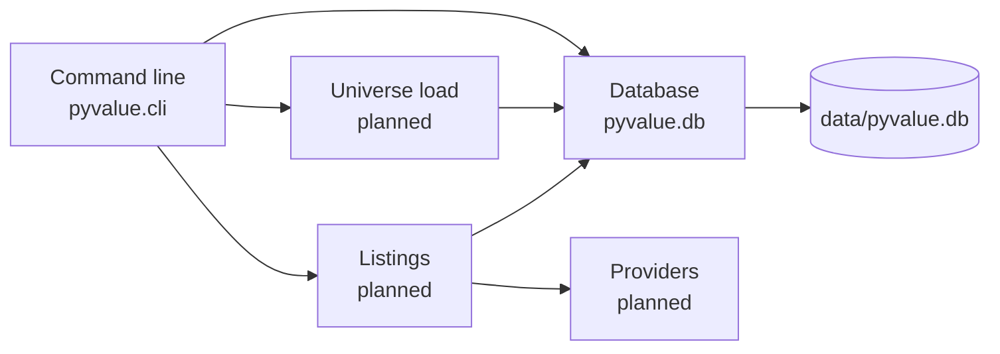

# Architecture

pyvalue is a value-investing toolkit: a curated global stock universe, data-quality checks on fundamental data, and quality-at-a-reasonable-price screening. This document describes how the code is organised. The reasons behind each decision are in the records under [`docs/adr/`](adr/).

Only what has been agreed is described as designed. Everything else is listed as planned or not designed yet.

## Components

| Component | Package | What it does | Status |
|---|---|---|---|
| Database | `pyvalue.db` | Opens the SQLite file, applies migrations, owns every SQL statement | Built |
| Command line | `pyvalue.cli` | Thin commands that call the components | Built: `pyvalue db migrate` |
| Universe load | `pyvalue.universe` | Reads the three SEC holdings filings into `company` and `instrument` (ADR 0004, ADR 0006) | Planned |
| Listings | `pyvalue.listings` | Looks up provider listings, applies the automatic rule and the decisions file (ADR 0005) | Planned |
| Providers | `pyvalue.providers` | The EODHD client | Planned |
| Prices, fundamentals, metrics, screens, data-quality reports, the agent that decides listings | | | Not designed yet |

## How the components fit together

An arrow means "calls". Nothing calls back up the arrows.

## Rules

| Rule | What it means |
|---|---|
| One home for database access | Only `pyvalue.db` imports `sqlite3` or contains SQL. Every other package calls functions of `pyvalue.db`. A test enforces the import rule. |
| Ids downstream | Code past the entry point works with row ids. An ISIN, a ticker or an exchange code is turned into an id once, at the boundary where it comes in. |
| Dependencies point one way | Command line, then components, then database. The database package knows nothing about the others. |
| Transactions are explicit | Connections are opened without implicit transactions. Code that writes begins and commits its own. |
| Foreign keys are always on | Every connection is opened with enforcement on, and opening fails if SQLite cannot enforce them. |

## The universe, as designed

The data model and the steps are fixed by the records; the code for the steps is not written yet.

| Step | What happens | Record |
|---|---|---|
| 1. Load | The SEC holdings filings of VTI, VXUS and DFAX are read into `company` and `instrument` | ADR 0004, ADR 0006 |
| 2. Look up | The provider's symbol lists are matched to instruments by ISIN | ADR 0005 |
| 3. Fill | A listing is written when the automatic rule applies | ADR 0005 |
| 4. Decide | An agent decides every other case; its decisions are kept in a committed file | ADR 0005 |

## Where things live

| Thing | Place | Committed |
|---|---|---|
| The database | `data/pyvalue.db`, relative to the folder pyvalue is run from. `--db PATH` points a command elsewhere | No |
| Downloaded SEC filings | `data/` | No |
| Migrations | `src/pyvalue/db/migrations/`, one numbered SQL file each (ADR 0007) | Yes |
| The agent's listing decisions | A file under version control; its path is settled when listings are built | Yes |
| Credentials | `private/config.toml` | No |
| Table documentation | `docs/database/`, one file per table | Yes |

Keep the database out of folders that a sync service copies while files are open, such as iCloud or Dropbox: a SQLite file can be corrupted there.

## The database

- **Schema.** Defined by the migration files. The tables are documented one per file under [`docs/database/`](database/).
- **Migrations.** `pyvalue db migrate` creates the database if it is missing and applies every migration it has not yet received, each in its own transaction. Applied migrations are recorded in the `schema_migration` table and are never edited afterwards. To change the schema, add the next numbered file to `src/pyvalue/db/migrations/`, update the table's file under `docs/database/`, and say in the commit message what the migration does to a local database.

## Tests

| Directory | Holds |
|---|---|
| `tests/unit/` | Tests of single functions and modules. Its tree mirrors `src/pyvalue/`: `tests/unit/db/` tests `pyvalue.db` |
| `tests/regression/` | One test per fixed bug, marked `regression` |
| `tests/integration/` | End-to-end runs on a small checked-in dataset, marked `integration` |
| `tests/conftest.py` | Shared fixtures, such as a temporary database at the latest schema version |

No test touches `data/pyvalue.db`. Every test that needs a database builds a temporary one.
