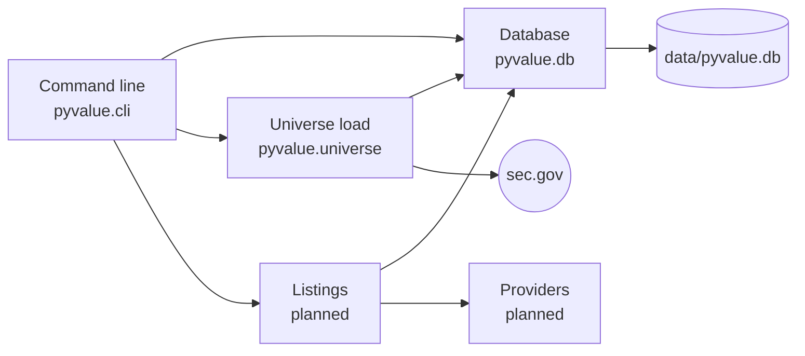

# Architecture

pyvalue is a value-investing toolkit: a curated global stock universe, data-quality checks on fundamental data, and quality-at-a-reasonable-price screening. This document describes how the code is organised. The reasons behind each decision are in the records under [`docs/adr/`](adr/).

Only what has been agreed is described as designed. Everything else is listed as planned or not designed yet.

## Components

| Component | Package | What it does | Status |
|---|---|---|---|
| Database | `pyvalue.db` | Opens the SQLite file, applies migrations, owns every SQL statement | Built: connections, migrations, the unit of work, and the repositories for `company` and `instrument`. A repository is added when a component first needs its table |
| Command line | `pyvalue.cli` | Thin commands that call the components | Built: `pyvalue db migrate`, `pyvalue universe load` |
| Universe load | `pyvalue.universe` | Downloads the three SEC holdings filings and reads them into `company` and `instrument`, applying the decisions file on legal-entity identifiers (ADR 0004, ADR 0006, ADR 0009, ADR 0010) | Built |
| Settings | `pyvalue.config` | Reads `private/config.toml` | Built: the SEC contact line |
| Listings | `pyvalue.listings` | Looks up provider listings, applies the automatic rule and the decisions file (ADR 0005) | Planned |
| Providers | `pyvalue.providers` | The EODHD client | Planned |
| Prices, fundamentals, metrics, screens, data-quality reports, the agent that decides listings | | | Not designed yet |

## How the components fit together



An arrow means "calls". Nothing calls back up the arrows. Two small modules are left out of the picture because everything may use them: `pyvalue.errors`, the base of pyvalue's own errors, and `pyvalue.config`, the settings.

The pattern for database access is Repository with Unit of Work (ADR 0008). The working rules, with what to flag in review, are in the **Database Access** section of [`CLAUDE.md`](../CLAUDE.md).

## Rules

| Rule | What it means |
|---|---|
| One home for database access | Only `pyvalue.db` imports `sqlite3`, holds a connection or contains SQL. A test enforces the import rule. |
| One repository class per table | Each table has one class in `pyvalue.db` that owns it. Every statement that reads or changes the table is a method of that class, and it returns typed, immutable records. |
| A unit of work owns the transaction | A component asks `pyvalue.db` for a unit of work and reaches the repositories through it. What it does inside is committed together or rolled back together. Repositories never commit, and components never see a connection. |
| Ids downstream | Code past the entry point works with row ids. An ISIN, a ticker or an exchange code is turned into an id once, at the boundary where it comes in. |
| Dependencies point one way | Command line, then components, then database. The database package knows nothing about the others. |
| One door into the database | Other packages import from `pyvalue.db` itself, never from a module inside it. What they get is `Database`, the records and the errors. A test enforces it. |
| Errors a person can fix are pyvalue's own | They derive from `PyvalueError`. The command line prints such an error as one line and exits with status 1. |
| Transactions are explicit | Connections are opened without implicit transactions, so nothing is committed except where a unit of work, or the migration run, says so. |
| Foreign keys are always on | Every connection is opened with enforcement on, and opening fails if SQLite cannot enforce them. |

## The universe, as designed

The data model and the steps are fixed by the records. Step 1 is built; the code for steps 2 to 4 is not written yet.

| Step | What happens | Record |
|---|---|---|
| 1. Load | The SEC holdings filings of VTI, VXUS and DFAX are read into `company` and `instrument`. Where the filings are wrong about a company's legal-entity identifier, a decisions file overrules them | ADR 0004, ADR 0006, ADR 0009, ADR 0010 |
| 2. Look up | The provider's symbol lists are matched to instruments by ISIN | ADR 0005 |
| 3. Fill | A listing is written when the automatic rule applies | ADR 0005 |
| 4. Decide | An agent decides every other case; its decisions are kept in a committed file | ADR 0005 |

## Where things live

| Thing | Place | Committed |
|---|---|---|
| The database | `data/pyvalue.db`, relative to the folder pyvalue is run from. `--db PATH` points a command elsewhere | No |
| Downloaded SEC filings | `data/sec/`, one file per filing, named by ticker and filing number | No |
| The load output | `data/universe/lines_not_loaded.csv` and `data/universe/cases_for_agent.csv`, rewritten by every load | No |
| Migrations | `src/pyvalue/db/migrations/`, one numbered SQL file each (ADR 0007) | Yes |
| Decisions on legal-entity identifiers | `src/pyvalue/universe/decisions/lei.csv`, one row per security, shipped inside the package (ADR 0010) | Yes |
| The agent's listing decisions | A file under version control, expected in the same folder; settled when listings are built | Yes |
| Credentials and the SEC contact line | `private/config.toml` | No |
| Table documentation | `docs/database/`, one file per table | Yes |

Keep the database out of folders that a sync service copies while files are open, such as iCloud or Dropbox: a SQLite file can be corrupted there.

## The database

- **Schema.** Defined by the migration files. The tables are documented one per file under [`docs/database/`](database/).
- **Migrations.** `pyvalue db migrate` creates the database if it is missing and applies every migration it has not yet received, each in its own transaction. Applied migrations are recorded in the `schema_migration` table and are never edited afterwards. To change the schema, add the next numbered file to `src/pyvalue/db/migrations/`, update the table's file under `docs/database/`, and say in the commit message what the migration does to a local database.

### How a component uses the database

```python
database = Database(path)
with database.unit_of_work() as work:
    company = work.companies.add(name=name, lei=lei)
    work.instruments.add(company_id=company.company_id, isin=isin)
# Both rows are saved here, or neither is.
```

| Topic | How it works |
|---|---|
| One module per table | `pyvalue/db/company.py` holds the `Company` record and `CompanyRepository`. The record sits beside its repository. |
| Which methods exist | Only the ones a component calls. A method is added, with its test, when it is first needed. |
| Errors | The `Repository` base class turns every `sqlite3` error into a `pyvalue.db` one. A row the schema refuses arrives as `ConstraintError`. |
| A database that is not ready | `unit_of_work()` refuses a missing file, without creating it, and a database that is not at the latest schema version. The message says to run `pyvalue db migrate`. |
| After the block | The connection is closed. A repository kept from an ended unit of work raises an error. |

## Tests

| Directory | Holds |
|---|---|
| `tests/unit/` | Tests of single functions and modules. Its tree mirrors `src/pyvalue/`: `tests/unit/db/` tests `pyvalue.db` |
| `tests/regression/` | One test per fixed bug, marked `regression` |
| `tests/integration/` | End-to-end runs on a small checked-in dataset, marked `integration` |
| `tests/fixtures/` | Checked-in sample data, such as three small made-up holdings filings |
| `tests/conftest.py` | Shared fixtures, such as a temporary database at the latest schema version |

No test touches `data/pyvalue.db`. Every test that needs a database builds a temporary one.
