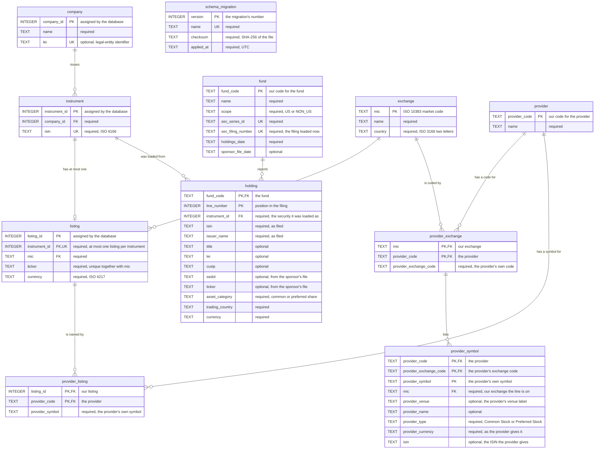

# Database

The pyvalue database is one SQLite file, `data/pyvalue.db` by default. Its schema is built by the migration files under `src/pyvalue/db/migrations/` (ADR 0007). This folder documents the schema as it is after the latest migration, one file per table.

## Tables

| Table | One row is | Decided in |
|---|---|---|
| [`exchange`](exchange.md) | A market on which companies list | ADR 0001 |
| [`company`](company.md) | A legal entity that issues securities | ADR 0001 |
| [`instrument`](instrument.md) | One security of a company, identified by its ISIN | ADR 0003 |
| [`listing`](listing.md) | The primary exchange line of an instrument | ADR 0003 |
| [`fund`](fund.md) | A fund whose holdings are loaded | ADR 0017 |
| [`holding`](holding.md) | One loaded share line of a fund's filing | ADR 0017, ADR 0021, ADR 0022 |
| [`provider`](provider.md) | A data provider, such as EODHD | ADR 0002 |
| [`provider_exchange`](provider_exchange.md) | The code one provider uses for one of our exchanges | ADR 0002 |
| [`provider_listing`](provider_listing.md) | The symbol one provider uses for one of our listings | ADR 0002 |
| [`provider_symbol`](provider_symbol.md) | One share line of a provider's symbol list | ADR 0018 |
| [`schema_migration`](schema_migration.md) | A migration that has been applied to this database | ADR 0007 |

## Views

| View | Gives | Described in |
|---|---|---|
| `provider_listing_address` | The two parts a provider needs to address a listing | [`provider_listing`](provider_listing.md#view-provider_listing_address) |

## Diagram

`PK` is a primary key, `FK` a foreign key, `UK` a unique column. `schema_migration` stands alone: it describes the database itself, not the data in it.

## How to read the table files

- **Key**: `PK` is the primary key; where two columns are marked `PK`, the pair is the key. `FK → table.column` is a foreign key to that column. `UNIQUE` means no two rows share the value.
- **Required**: `yes` means the column can never be empty. `no` means an empty value is a valid state, and the Meaning column says what it stands for.
- **Constraint**: the rule the database enforces, in plain words. The exact SQL is in the migration file.

## Rules that hold for every table

| Rule | What it means |
|---|---|
| Foreign keys are enforced | Every connection is opened with `PRAGMA foreign_keys = ON`. |
| Nothing is deleted implicitly | A row that another row points at cannot be deleted. |
| Ids are never reused | A deleted row's id is never given to a new row. |
| A corrected code follows through | Changing an exchange's `mic`, a provider's `provider_code` or a fund's `fund_code` updates every row that points at it. |
| Check digits are validated in code | The database enforces the shape of an ISIN and a legal-entity identifier. Their check digits are validated by the code that writes the row. |

## Changing the schema

Add the next numbered file under `src/pyvalue/db/migrations/`, update the table's file here in the same commit, and run `pyvalue db migrate`. A migration that has been applied is never edited.
